# CineBot – Parallel Agent Execution Plan

| | |
| --- | --- |
| Purpose | Split the v1 build (`IMPLEMENTATION-PLAN.md`) into tasks that several AI coding agents can run **in parallel, consistently and correctly** |
| Worker model | Grok 4.7 high fast (`grok-4.7-high-fast`) |
| Integrator | One strong model plus the project owner (contract, shared files, reviews, merges, gates) |
| Sources of truth | `PRD.md`, `RULES.md`, `ARCHITECTURE.md`, `DESIGN.md`, `docs/api/openapi.yaml` (after Wave 0) |
| Last updated | 2026-11-11 |

---

## 1. How parallel work stays consistent

Parallel agents fail in three predictable ways: they make conflicting assumptions, they edit the same files, or they invent business rules. This plan prevents each of these.

| Risk | Countermeasure |
| --- | --- |
| Conflicting assumptions about APIs | **Contract first.** `docs/api/openapi.yaml` is written and frozen before any feature work (`ER-24`). The backend implements it. The frontend generates types from it and mocks it with MSW. |
| Conflicting assumptions between modules | **Ports first.** Wave 0 creates every cross-module Java interface (`SeatInventory`, `PricingService`, `TicketService`…) with Javadoc. Feature tasks implement or consume them; they never redesign them. |
| Conflicting rule implementations | **Shared fixtures.** The orphan-rule, pricing and membership cases live in `shared/fixtures/*.json` and are run by both the Java and the TypeScript tests (`ER-20`). |
| Merge conflicts | **File ownership** (§4). Every task lists the paths it may edit. Shared files change only through the integrator (`ER-25`). |
| Invented rules | Agents implement `RULES.md` exactly. Anything unclear is reported as a question, not guessed. |
| Hidden breakage | Each task must pass the full verification commands. Each wave ends with a gate: merge, full CI, review (§7). |
| Context drift | `.cursor/rules/*.mdc` load the core rules automatically into every agent session. |

### 1.1 Execution mechanics

- Each task runs as a **separate subagent in its own git worktree and branch**, using Cursor's `best-of-n-runner` subagent type with model `grok-4.7-high-fast`. The branch name is `agent/<task-id>-<slug>`, for example `agent/b5a-seat-inventory`.
- **Worktrees are created from committed `HEAD`.** Before launching a wave, everything the agents need must be committed: docs, `.cursor/rules`, and the previous wave's merges.
- Tasks in the same wave run at the same time. A wave starts only after the previous gate has passed.
- The integrator merges task branches into `main` in the order listed for the wave, rebasing later branches if needed.

### 1.2 Machine prerequisites (Windows)

| Tool | Version | Used by |
| --- | --- | --- |
| JDK | 21 | Backend (`mvnw.cmd`) |
| Docker Desktop | running | Testcontainers (PostgreSQL 16, Redis 7) and `docker compose` |
| Node.js | 20 LTS or newer | Frontend |
| pnpm | 9 | Frontend package manager (one lockfile: `pnpm-lock.yaml`) |
| Git | recent | Worktrees |

### 1.3 Verification commands (every task, every gate)

```powershell
# Backend
cd backend; .\mvnw.cmd -B verify

# Frontend
cd frontend; pnpm install --frozen-lockfile; pnpm lint; pnpm typecheck; pnpm test --run; pnpm build
```

A task that touches only one side runs only that side's commands. The integrator runs both at each gate.

---

## 2. Roles

| Role | Responsibilities |
| --- | --- |
| **Owner (human)** | Answers product questions. Creates external accounts (VNPay sandbox, hosting, SMTP). Approves each gate. |
| **Integrator** | Writes and owns the contract (W0-1). Owns shared files. Launches agents with the task cards (§5). Reviews and merges. Runs the gates (§7). Updates `PROGRESS.md`. |
| **Worker agents (Grok 4.7 high fast)** | Each executes exactly one task card inside its owned paths. Delivers code, tests and a report in the format of §6.1. |

---

## 3. Wave overview

```mermaid
flowchart LR
    subgraph W0[Wave 0 – Foundation]
      C[W0-1 Contract + fixtures] --> BS[W0-2 Backend skeleton]
      C --> FS[W0-3 Frontend skeleton]
    end
    subgraph W1[Wave 1 – Domain and catalogue]
      B1[B1 Domain rules]; B2[B2 Catalogue + seed]; B3[B3 Schedule]; B4[B4 Auth]
      F1[F1 FE domain]; F2[F2 FE catalogue]; F3[F3 FE auth]
    end
    subgraph W2[Wave 2 – Booking core]
      B5a[B5a Redis SeatInventory]; B5b[B5b Booking API]; F4[F4 FE booking]
    end
    subgraph W3[Wave 3 – Payment, tickets, membership]
      B6[B6 Payment]; B7[B7 Tickets + email + lookup]; B8[B8 Membership]
      F5[F5 FE checkout]; F6[F6 FE account]
    end
    subgraph W4[Wave 4 – Admin and demo]
      B9[B9 Admin content]; B10[B10 Admin ops]; B11[B11 Demo reset]
      F7[F7 FE admin content]; F8[F8 FE admin ops]
    end
    subgraph W5[Wave 5 – Integration and release]
      I1[I1 Integration + E2E] --> I2[I2 Deploy + README]
    end
    W0 --> W1 --> W2 --> W3 --> W4 --> W5
```



| Wave | Tasks in parallel | Gate | Matching phases in `PROGRESS.md` |
| --- | --- | --- | --- |
| 0 | W0-1, then W0-2 and W0-3 | G0 | Phase 0 |
| 1 | B1, B2, B3, B4, F1, F2, F3 (7) | G1 | Phases 1–2 |
| 2 | B5a, B5b, F4 (3) | G2 + security review | Phase 3 |
| 3 | B6, B7, B8, F5, F6 (5) | G3 + security review | Phases 4–5 |
| 4 | B9, B10, B11, F7, F8 (5) | G4 | Phase 6 |
| 5 | I1, then I2 | G5 (release) | Phase 7 |

---

## 4. Ownership rules

### 4.1 Shared files (integrator-only after Wave 0)

| File / path | Created by | Rule |
| --- | --- | --- |
| `docs/api/openapi.yaml`, `shared/fixtures/**` | W0-1 | Frozen at G0. Agents report proposed changes as *Contract issue*. |
| `backend/pom.xml`, `frontend/package.json`, `pnpm-lock.yaml` | W0-2 / W0-3 | All dependencies are added in Wave 0. A missing library is reported, not added. |
| `common/error/ErrorCode.java` | W0-2 | Contains every code from `ARCHITECTURE.md` §9.2. |
| `common/security/SecurityConfig.java` | W0-2 | Implements the full authorization matrix (`ARCHITECTURE.md` §7.4). |
| `V1__schema.sql` | W0-2 | Full v1 schema (`ARCHITECTURE.md` §5.2). Never edited after G0. |
| Cross-module interfaces (`*/application/*Service.java` ports, `SeatInventory`) | W0-2 | Signatures are frozen. Implementations belong to the tasks below. |
| `frontend/src/app/router.tsx`, layouts, `Nav` | W0-3 | All routes exist from Wave 0. Feature tasks replace page and slot files only. |
| `frontend/src/lib/api/client.ts`, `schema.d.ts` | W0-3 | Types are regenerated only by the integrator after a contract change. |
| `docs/PROGRESS.md`, `docs/RULES.md` and the other docs | Integrator | Agents propose doc changes in their report. |
| `.github/workflows/**`, `docker-compose.yml`, `.env.example` | Wave 0 / integrator | |

### 4.2 Pre-assigned Flyway versions

`V1` contains the full schema. If a task genuinely needs a schema change, it uses its own range and explains why in its report. The local profile sets `spring.flyway.out-of-order=true`, so ranges can merge in any order. CI always starts from an empty database.

| Range | Task | Range | Task |
| --- | --- | --- | --- |
| V10–V19 | B2 | V50–V59 | B6 |
| V20–V29 | B3 | V60–V69 | B7 |
| V30–V39 | B4 | V70–V79 | B8 |
| V40–V49 | B5a / B5b | V80–V99 | B9, B10, B11 |

### 4.3 Seed data ownership

| File (`backend/src/main/resources/seed/`) | Owner |
| --- | --- |
| `cinema.json`, `rooms.json`, `movies.json`, `genres.json`, `snacks.json` | B2 |
| `templates.json` | B3 |
| `users.json` (demo member, demo VIP, admin) | B4 |

### 4.4 Frontend namespaces and mocks

Each feature owns its i18n namespace files (`src/i18n/locales/{vi,en}/<ns>.json`) and its MSW handler file (`src/mocks/handlers/<feature>.ts`). W0-3 creates them empty; the owner fills them.

| Namespace / handler | Owner | Namespace / handler | Owner |
| --- | --- | --- | --- |
| `common`, `errors` | W0-3, then F1 | `checkout` / `checkout.ts` | F5 |
| `catalog` / `catalog.ts` | F2 | `account` / `account.ts` | F6 |
| `auth` / `auth.ts` | F3 | `admin-content` / `admin-content.ts` | F7 |
| `booking` / `booking.ts` | F4 | `admin-ops` / `admin-ops.ts` | F8 |

---

## 5. Task cards

Paths are abbreviated. `BE` means `backend/src/main/java/com/cinebot/`, `BT` means `backend/src/test/java/com/cinebot/`, `RES` means `backend/src/main/resources/`, and `FE` means `frontend/src/`. Every task also owns the tests for the code it writes.

### Wave 0 – Foundation

#### W0-1 Contract and fixtures (integrator; a worker may draft it)
- **Depends on:** nothing.
- **Owns:** `docs/api/openapi.yaml`, `docs/api/README.md`, `shared/fixtures/*.json`.
- **Inputs:** `ARCHITECTURE.md` §7, §9; `RULES.md` BR-02…BR-25; `PRD.md` §5.
- **Deliverables:**
  - **OpenAPI 3.1 file** covering every v1 endpoint in `ARCHITECTURE.md` §9.1, including admin. It specifies:
    - request and response schemas, with an example for each;
    - `ProblemDetail` responses with the exact `code` values from §9.2;
    - the headers `X-Booking-Token`, `X-Client-Id` and `Accept-Language`;
    - security schemes;
    - the seat-map response, including `inventoryAvailable`, `HELD_BY_YOU` and seat coordinates. Row versions stay internal to Redis.
  - **`orphan-rule-cases.json`:** the 11 cases from `BR-08` plus edge cases (existing gaps, row ends, couple rows ignored, multi-row selections).
  - **`pricing-cases.json`:** every day type, a 00:30 screening, student and couple tickets, snack VIP rounding (79,000 → 67,000), and totals.
  - **`membership-cases.json`:** earning, the 12-month expiry, the VIP threshold crossed and expired, with fixed clocks.
- **Done when:** `npx @redocly/cli lint docs/api/openapi.yaml` passes, the fixtures are valid JSON with a short `description` for each case, and the owner approves.

#### W0-2 Backend skeleton
- **Depends on:** W0-1.
- **Owns:** `backend/**` and `docker-compose.yml`.
- **Deliverables:**
  - **Project setup:**
    - Maven wrapper project, Java 21, Spring Boot latest stable;
    - every dependency from `ARCHITECTURE.md` §2;
    - Spotless or Checkstyle configuration.
  - **`docker-compose.yml`:** `postgres:16` and `redis:7` with `--appendonly yes`.
  - **Configuration:** `application.yml` with the profiles `local`, `test`, `demo` and `prod`.
  - **Packages:** every module from `ARCHITECTURE.md` §4.1, each with `api/application/domain/infra` and a `package-info.java`.
  - **Schema:** `V1__schema.sql` with the full schema, including the extensions, the overlap exclusion constraint, `sold_seats` and the first `pricing_policies` row.
  - **Common layer:**
    - `ErrorCode`, `ApiException`, and a `GlobalExceptionHandler` that returns `ProblemDetail` with `code`;
    - a `Clock` bean and the `Accept-Language` locale resolver;
    - id generation and the booking-code generator.
  - **Security:** `SecurityConfig` with the full authorization matrix, a JWT decoder/encoder (HS256 from an environment variable), CORS and same-site cookie settings.
  - **Ports:** exactly the interfaces and records of the port catalogue (§8), with Javadoc and no logic, plus one `@Fallback` bean per port.
  - **No JPA entities:** entities and repositories belong to the feature tasks. `ddl-auto=validate` passes with no entities.
  - **Shared value types:** `TicketType`, `DayType`, `BookingStatus`, `Channel` and `SeatRef`.
  - **Redis infrastructure:**
    - Lettuce `StringRedisTemplate`;
    - `LuaScriptRegistry`, which loads `classpath:redis/*.lua` via `EVALSHA`;
    - Bucket4j with the Redis backend behind a `RateLimiter` interface;
    - ShedLock with the Redis provider.
  - **Tests infrastructure:**
    - `IntegrationTestBase` with reusable Testcontainers (PostgreSQL + Redis);
    - `SharedFixtures`, which reads `../shared/fixtures`.
  - **Smoke tests:** context loads, Flyway applies, and `ProblemDetail` has the right shape.
  - **Delivery files:** `.github/workflows/backend.yml`, `.env.example`, and a root `.gitattributes` (`* text=auto`, with `eol=lf` for `mvnw`, `*.sh` and `*.lua`, so Linux CI can run the wrapper).
- **Done when:** `mvnw verify` passes and `/v3/api-docs` and `/actuator/health` (PostgreSQL + Redis) respond.

#### W0-3 Frontend skeleton
- **Depends on:** W0-1.
- **Owns:** `frontend/**`.
- **Deliverables:**
  - **Prototype:** move `App.tsx` to `frontend/prototype/App.prototype.tsx`. It is not imported; it stays as a reference until Wave 4.
  - **Dependencies:**
    - Remove the unused ones (MUI, emotion, react-slick, react-dnd, recharts unless used by the dashboard, etc.).
    - Add every needed one: TanStack Query, Zustand, axios, i18next, react-i18next, react-hook-form, zod, `@hookform/resolvers`, `qrcode.react`, MSW, openapi-typescript, Vitest, Testing Library, jsdom, ESLint, Prettier.
  - **Scripts:** `dev`, `build`, `lint`, `typecheck`, `test`, `gen:api`. Generate `FE/lib/api/schema.d.ts`.
  - **`FE/lib/api/client.ts`:** all the headers and the single-flight refresh from `ARCHITECTURE.md` §11, plus `FE/lib/clientId.ts`.
  - **App shell:**
    - `FE/app/router.tsx` with **every** route from `DESIGN.md` §7.1, lazy-loading placeholder pages at their final paths;
    - the Public and Admin layouts, `Nav` with an `<AccountMenu/>` slot (`FE/features/auth/AccountMenu.tsx` placeholder), `Footer` and `LanguageSwitcher`.
  - **i18n:** set up with every namespace file from §4.4 in both languages, plus `common` and `errors` (all error codes).
  - **MSW:** set up with the empty per-feature handler files, enabled when `VITE_USE_MOCKS=true`.
  - **Styling:** design tokens with the contrast fixes, typography classes and Vietnamese-capable fonts (`DESIGN.md` §3–4).
  - **CI:** `.github/workflows/frontend.yml`.
- **Done when:** the frontend verification commands pass, every route renders its placeholder, and the language switch works.

**Gate G0:**
- Both CIs pass.
- Contract tagged `contract-v1.0.0`.
- Docs and `.cursor/rules` committed.

### Wave 1 – Domain and catalogue

#### B1 Domain rules (pure Java)
- **Depends on:** G0.
- **Owns:**
  - `BE/booking/domain/rule/**` (`OrphanSeatRule`, `SeatSelection`);
  - `BE/pricing/**` (`PriceCalculator`, `DayTypeResolver`, `SnackDiscount` in `domain`; the `pricing_policies` repository and `PricingService` implementation in `application`/`infra`);
  - `BE/membership/domain/**` (`MembershipPolicy`: points, qualifying sum, VIP decision).
- **Inputs:** BR-02…BR-08, BR-16…BR-19.
- **Tests:** all three shared fixture files, plus property-style tests (no rule violation for random valid selections).
- **Done when:** no Spring imports in these packages, and 100% of fixture cases pass.

#### B2 Catalogue, cinema and seed
- **Depends on:** G0.
- **Owns:**
  - `BE/catalog/**` and `BE/cinema/**`;
  - `BE/demo/seed/**` (catalogue loader);
  - the seed files from §4.3.
- **Deliverables:**
  - Entities and repositories.
  - `RoomLayoutGenerator` for the five rooms (`ARCHITECTURE.md` §5.5).
  - Public `GET /api/movies`, `/api/movies/{slug}`, `/api/cinema`, `/api/snacks`, with translations by locale.
  - Redis cache for the catalogue.
  - An idempotent seed loader (profiles `local` and `demo`).
- **Tests:**
  - layout counts for each room;
  - the seed is idempotent;
  - the API responses match the contract examples.

#### B3 Schedule
- **Depends on:** G0.
- **Owns:** `BE/schedule/**`, `BE/booking/infra/occupancy/**` (implements `ShowtimeOccupancy`, see §8), `seed/templates.json`.
- **Deliverables:**
  - Template and showtime entities.
  - `RollingShowtimeGenerator`, run by a job, at startup, and through a lazy guard (BR-25).
  - Simulated occupancy: one walk-in `CONFIRMED` booking (channel `ADMIN`) per showtime, with its `sold_seats` (15–35%).
  - `GET /api/movies/{slug}/showtimes` and `GET /api/showtimes/{id}` with prices via `PricingService`.
  - The seats-left count, using `SeatInventory.heldCount` through the port.
- **Tests:**
  - the overlap constraint;
  - idempotent generation;
  - occupancy never creates orphans;
  - fixed-clock day boundaries.
- **Note:** use test doubles for the ports that land in other tasks.

#### B4 Auth and users
- **Depends on:** G0.
- **Owns:** `BE/auth/**`, `BE/user/**` (except `MyBookingsController`), `seed/users.json`.
- **Deliverables:**
  - `register`, `login`, `refresh`, `logout`;
  - `refresh_tokens` with family rotation, reuse detection and the 10-second grace (`ARCHITECTURE.md` §7.2);
  - `GET/PUT /api/me`;
  - login rate limit;
  - demo users.
- **Tests:**
  - rotation;
  - reuse revokes the whole family;
  - grace window;
  - cookie attributes;
  - role checks against `SecurityConfig`.

#### F1 Frontend domain and infrastructure
- **Depends on:** G0.
- **Owns:**
  - `FE/features/booking/domain/**` (`orphanRule.ts`, `selection.ts`) and `FE/features/booking/store.ts`;
  - `FE/lib/money.ts`, `FE/lib/dates.ts`, `FE/lib/errors.ts`, `FE/hooks/useCountdown.ts`;
  - `common` and `errors` namespaces.
- **Tests:**
  - the shared orphan and pricing fixtures (display totals);
  - VI/EN formatting;
  - store persistence.

#### F2 Frontend catalogue
- **Depends on:** G0.
- **Owns:**
  - `FE/features/movies/**`, `FE/features/showtimes/**`;
  - the Home, MovieDetail and Cinema pages;
  - `catalog` namespace and handlers.
- **Deliverables:** `DESIGN.md` §8.1, §7.2:
  - Now showing / Coming soon tabs;
  - hover and focus info;
  - trailer dialog;
  - `DateStrip` and `ShowtimeList`;
  - loading, empty and error states.
- **Tests:** components with MSW; accessibility basics (focus, labels).

#### F3 Frontend auth
- **Depends on:** G0.
- **Owns:** `FE/features/auth/**` (including `AccountMenu.tsx`), `FE/app/ProtectedRoute.tsx`, `auth` namespace and handlers.
- **Deliverables:**
  - auth modal (login and register);
  - auth store (access token in memory);
  - bootstrap refresh on load;
  - role-based guard for `/admin`.
- **Tests:** login flow; a 401 triggers a single refresh; the guard redirects.

**Gate G1:**
- Merge order: B1, B2, B3, B4, F1, F2, F3.
- Full CI.
- Bugbot review of the wave diff.
- The ports used by B3 have real implementations, or tracked follow-ups.

### Wave 2 – Booking core

#### B5a Redis seat inventory
- **Depends on:** G1 (B1 `OrphanSeatRule`).
- **Owns:**
  - `BE/booking/infra/redis/**`;
  - `RES/redis/*.lua`;
  - `BE/booking/application/SeatHoldCoordinator.java`;
  - `BE/booking/application/SoldSetReconcileJob.java`.
- **Inputs:** `ARCHITECTURE.md` §6 (the whole section), `RULES.md` ER-10, ER-10a.
- **Deliverables:**
  - **Lua scripts:** `load_sold`, `snapshot`, `commit_hold`, `release_hold`, `extend_hold`, `claim_for_sale`, `mark_sold`.
  - **`RedisSeatInventory`**, which implements `SeatInventory`.
  - **`SeatHoldCoordinator`:** snapshot → validate with `SelectionValidator` (orphan rule) → commit, retrying up to 3 times on `VERSION_CHANGED`.
  - **Sold-mirror loading** and the **reconcile job** (every minute, ShedLock).
  - **Pub/sub events.**
  - **Health indicator.**
  - A typed `SeatInventoryUnavailableException` on any Redis error.
- **Tests** (Testcontainers Redis):
  - every script result branch;
  - 20 threads on one seat → exactly 1 winner;
  - the neighbouring-seat race (A3 vs A5) never produces an orphan;
  - TTL expiry;
  - `extend_hold` returning `LOST`;
  - mirror rebuild after `FLUSHALL`;
  - Redis stopped → typed exception.

#### B5b Booking application and API
- **Depends on:** G1. Develop against an in-memory `SeatInventory` fake (test scope); merge after B5a.
- **Owns:**
  - `BE/booking/**`, except the paths owned by B5a, B6 and B7;
  - `BookingAdminService` is excluded (B10).
- **Deliverables:**
  - **Endpoints:**
    - `GET /api/showtimes/{id}/seat-map` (PG sold + Redis snapshot, `inventoryAvailable`, `HELD_BY_YOU`);
    - `POST /api/bookings`;
    - `GET /api/bookings/{id}`;
    - `PUT /api/bookings/{id}/snacks`;
    - `PUT /api/bookings/{id}/customer`;
    - `DELETE /api/bookings/{id}`.
  - **Booking token:** issuing, hashing and the `X-Booking-Token` check.
  - **Hold rules:** one active hold per owner (`cb:holdowner`), with a compensating release if the PostgreSQL insert fails.
  - **Rules applied:** price snapshot (BR-02, BR-03), VIP snack discount (BR-19), BR-05 / BR-07 / BR-23 / BR-24 checks.
  - **`HoldExpiryJob`.**
  - **Rate limit** on hold creation; `503 SEAT_SERVICE_UNAVAILABLE`.
  - `confirmPaid` stays unimplemented here (B6).
- **Tests:**
  - API tests for every error code in the contract;
  - token access;
  - one hold per owner;
  - expiry;
  - Redis-down behaviour for both the seat map and hold creation.

#### F4 Frontend booking
- **Depends on:** G1 (F1 store and domain).
- **Owns:**
  - `FE/features/booking/components/**` (`TicketCounter`, `SeatMap`, `SnackPicker`, `HoldCountdown`, `BookingSummaryBar`);
  - `FE/pages/BookingPage.tsx`;
  - `booking` namespace and handlers.
- **Deliverables:**
  - `DESIGN.md` §6.3 and §8.2:
    - keyboard navigation in the seat map;
    - live validation;
    - polling every 5 s;
    - handling of 409, 410, 422 and 503;
    - the inventory-unavailable banner;
    - releasing the hold on Back.
  - Components stay presentational (`ER-17`).
- **Tests:**
  - seat selection, including orphan highlighting;
  - error flows through MSW;
  - accessibility (roles, labels, focus).

**Gate G2:**
- Merge order: B5a, B5b, F4.
- Full CI.
- Bugbot review.
- **Security review** (auth + holds + booking token).
- A manual run of the booking flow against the real backend.

### Wave 3 – Payment, tickets, membership

#### B6 Payment
- **Depends on:** G2.
- **Owns:** `BE/payment/**`, `BE/booking/application/BookingConfirmationService.java` (`confirmPaid`).
- **Deliverables:**
  - **Gateways:** `MockGateway` and `VnPayGateway` (signature, return URL, IPN).
  - **Payment start:** `POST /api/bookings/{id}/payments`, which calls `extend_hold` (`LOST` → 410) and creates the payment.
  - **Payment callbacks:** VNPay IPN and return, and `POST /api/payments/mock/{id}`.
  - **`confirmPaid`** exactly as in `ARCHITECTURE.md` §6.6:
    - payment `FOR UPDATE`;
    - `claim_for_sale`;
    - insert into `sold_seats`;
    - tickets, points and email through the ports;
    - after commit, `mark_sold`;
    - the `NEEDS_ATTENTION` path.
  - **Reconciliation job.**
- **Tests:**
  - IPN replay is idempotent;
  - wrong signature or amount is rejected;
  - late payment, both with seats free and with seats taken;
  - `confirmPaid` while Redis is down still sells exactly once;
  - a concurrent IPN and the reconciliation job.

#### B7 Tickets, email and lookup
- **Depends on:** G2.
- **Owns:**
  - `BE/ticket/**`, `BE/notification/**`;
  - `RES/templates/email/**`;
  - `BE/booking/api/BookingLookupController.java`, `BE/booking/application/BookingLookupService.java`.
- **Deliverables:**
  - `TicketService.issue`: one ticket per seat unit, a couple seat admits 2, an opaque QR token.
  - `GET /api/bookings/{id}/tickets`.
  - `POST /api/bookings/lookup` (rate-limited, masked phone number).
  - Email outbox, VI/EN Thymeleaf templates, and `EmailOutboxJob` with retries.
- **Tests:**
  - ticket counts per seat type;
  - lookup rate limit and masking;
  - outbox retry;
  - template rendering in both languages.

#### B8 Membership
- **Depends on:** G2.
- **Owns:** `BE/membership/**` (except `domain`, which is B1's, unless a bug fix is reported), `BE/user/api/MyBookingsController.java`.
- **Deliverables:**
  - **`MembershipService`:** `earn` on confirm, `reverse` on refund, `evaluateVip`, `snackDiscountFor`.
  - **`VipEvaluationJob`.**
  - **Endpoints:** `GET /api/me/membership` (balance, progress, ledger) and `GET /api/me/bookings`.
- **Tests:**
  - fixed-clock scenarios from `membership-cases.json`;
  - expiry;
  - the VIP gain and loss notifications are enqueued.

#### F5 Frontend checkout
- **Depends on:** G2.
- **Owns:**
  - `FE/features/checkout/**` and the Checkout, PaymentResult, DemoPay and Lookup pages;
  - the `TicketCard` component (screen and print);
  - `checkout` namespace and handlers.
- **Deliverables:** `DESIGN.md` §8.3, §8.4 (lookup):
  - three steps, where members skip step 1;
  - the hold-expired dialog;
  - the result page that polls status;
  - QR rendering;
  - print styles.
- **Tests:** guest vs member steps; expiry dialog; result polling.

#### F6 Frontend account and membership
- **Depends on:** G2.
- **Owns:** `FE/features/membership/**`, `FE/features/account/**`, the Account and Membership pages, `account` namespace and handlers.
- **Deliverables:** `DESIGN.md` §8.4: profile, my bookings (with tickets), points ledger, VIP progress, and the public membership info page.
- **Tests:** progress calculation display; empty states.

**Gate G3:**
- Merge order: B7, B8, B6, F5, F6. B6 last on the backend because it wires the ports.
- Full CI.
- Bugbot review.
- **Security review** (payment, IPN, lookup).
- End-to-end Demo Pay flow by hand.

### Wave 4 – Admin and demo

#### B9 Admin content API
- **Owns:**
  - `BE/admin/content/**`, `BE/admin/audit/**`;
  - `BE/catalog/application/*AdminService.java`, `BE/cinema/application/*AdminService.java`.
- **Deliverables:**
  - Movies CRUD, with translations, genres and credits.
  - Snacks CRUD.
  - Rooms: generate a layout; block and unblock seats (room-level `is_active`).
  - Seed protection (BR-26).
  - `AuditService` and `GET /api/admin/audit-log`.
- **Tests:** CRUD; `SEED_PROTECTED`; audit entries written; admin role required.

#### B10 Admin operations API
- **Owns:**
  - `BE/admin/ops/**`;
  - `BE/schedule/application/*AdminService.java`, `BE/pricing/application/*AdminService.java`, `BE/booking/application/BookingAdminService.java`.
- **Deliverables:**
  - Showtimes: create (overlap → 409) and cancel.
  - Templates CRUD and regenerate.
  - Pricing policy versions.
  - Bookings search and detail; refund (deletes `sold_seats`, voids tickets, reverses points, refreshes the Redis sold mirror).
  - Dashboard queries.
- **Tests:** overlap; refund side effects across PostgreSQL and Redis; dashboard numbers on a seeded fixture.

#### B11 Demo reset
- **Owns:** `BE/demo/reset/**`, demo-mode configuration.
- **Deliverables:**
  - **`DemoResetJob` at 03:00:**
    - purge stale bookings;
    - restore the seed and demo accounts;
    - regenerate the rolling week and occupancy;
    - clear the Redis keys of past showtimes.
  - **Release offsets** for coming-soon movies.
  - **`DEMO_MODE` banner flag** in `/api/cinema`.
- **Tests:** two resets in a row give the same state; demo accounts are restored; no orphans after the reset.

#### F7 Frontend admin content
- **Owns:**
  - `FE/features/admin/content/**`, plus the admin pages for Dashboard, Movies, Snacks, Rooms and Audit log;
  - `admin-content` namespace and handlers.
- **Deliverables:** the screens from `DESIGN.md` §8.5, reusing the prototype's admin look.
- **Tests:** form validation; table states.

#### F8 Frontend admin operations
- **Owns:**
  - `FE/features/admin/ops/**`, plus the admin pages for Showtimes (timeline), Templates, Pricing and Bookings;
  - `admin-ops` namespace and handlers.
- **Tests:** timeline overlap feedback; refund confirmation dialog.

**Gate G4:**
- Merge order: B9, B10, B11, F7, F8.
- Full CI.
- Bugbot review.
- Delete `frontend/prototype/`.

### Wave 5 – Integration and release

#### I1 Integration and end-to-end tests
- **Depends on:** G4.
- **Owns:** `e2e/**`, plus integration fixes across the code base (reviewed file by file).
- **Deliverables:**
  - Run the frontend against the real backend with mocks off, and fix the mismatches.
  - Playwright tests: guest Demo Pay; member with VIP discount; seat conflict between two browsers; hold expiry.
  - CI check comparing springdoc `/v3/api-docs` with the contract (`openapi-diff`).

#### I2 Deploy and README
- **Depends on:** I1.
- **Owns:** `Dockerfile`, deployment config, `README.md`, `docs/DEPLOY.md`.
- **Deliverables:**
  - **Backend image.**
  - **Hosting:** frontend on Vercel with the `/api` rewrite (same site), managed PostgreSQL, and Upstash Redis (`rediss://`).
  - **Secrets checklist** and **uptime ping**.
  - **README:** screenshots, architecture diagrams and demo credentials.

**Gate G5:**
- The release criteria from `IMPLEMENTATION-PLAN.md` §10 and the acceptance criteria in `PRD.md`.
- Owner sign-off.

---

## 6. Agent prompt and report

### 6.1 Prompt template (filled in by the integrator for each task)

```text
You are a senior engineer implementing task <ID> – <title> of the CineBot project.
Repository: this worktree (branch agent/<id>-<slug>). Work only here.

READ FIRST (mandatory, in this order):
- docs/RULES.md (all ER-* rules and the BR-* rules listed below)
- docs/ARCHITECTURE.md sections: <list>
- docs/DESIGN.md sections: <list, frontend tasks>
- docs/api/openapi.yaml paths: <list>
- docs/AGENT-EXECUTION-PLAN.md §4 (ownership) and your task card below

SKILLS (technique only; the docs above win on any conflict):
- .cursor/skills/<skill>/SKILL.md for each skill listed for <ID> in AGENT-EXECUTION-PLAN.md §9.1

TASK CARD:
<paste the full card from §5>

HARD CONSTRAINTS:
1. Edit ONLY files under your owned paths. Need a change elsewhere? Stop and report it.
2. Do not change docs/api/openapi.yaml, shared fixtures, pom.xml, package.json, lockfiles,
   SecurityConfig, ErrorCode, router.tsx or V1__schema.sql.
3. Never invent business rules or values. If RULES.md is unclear, choose nothing: report a question.
4. Use the injected Clock; money is long VND; errors are ProblemDetail codes; no user-facing strings in the backend.
5. Seat holds only through SeatInventory/Lua (ER-10). Do not touch Redis keys elsewhere.
6. Frontend: generated API types only, i18n keys in both vi and en, design tokens only.
7. No TODOs, no disabled or weakened tests, no commented-out code in delivered files.

WORKFLOW:
1. Write a short plan (files to create, tests to write) before coding.
2. Implement with tests next to the code. Cover every behaviour listed under "Tests".
3. Run the verification commands from §1.3 until they pass. Do not skip failures.
4. Self-review against the checklist in §6.3.
5. Commit with Conventional Commits on your branch.

FINAL REPORT (exact format):
## Summary
## Files changed
## Tests (commands run + results)
## Deviations from docs/contract (with reasons) – or "None"
## Questions / contract issues – or "None"
## Suggested doc updates – or "None"
```

### 6.2 What the integrator checks in each report and diff

1. `git diff --stat main...<branch>` touches only owned paths.
2. The verification commands pass in CI, not just as claimed.
3. The listed tests exist and assert the behaviours, not just that the code runs.
4. Each deviation and question is resolved: contract or doc update by the integrator, or a follow-up task.
5. `PROGRESS.md` is updated after the merge.

### 6.3 Self-review checklist (agents)

- [ ] Every BR or ER referenced in the card is implemented as written.
- [ ] Error codes match `ARCHITECTURE.md` §9.2 and the contract.
- [ ] No direct `Instant.now()`, `LocalDateTime.now()` or `new Date()` in business code.
- [ ] No entity is exposed by a controller. DTOs are validated.
- [ ] No personal data in logs.
- [ ] Every new string exists in both `vi` and `en`.
- [ ] Interactive elements are reachable by keyboard and labelled.
- [ ] Tests are deterministic: fixed clock, no sleeps longer than needed, no order dependence.

---

## 7. Gates

Each gate runs these steps in order:

1. Merge task branches in the listed order, rebasing as needed.
2. Run both verification commands on `main`. CI must be green.
3. Run the **Bugbot review** (`review-bugbot` skill) on the wave diff and fix or triage every finding.
4. **G2 and G3 only:** run the **Security review** (`review-security` skill).
5. Do a manual smoke test of the wave's user-visible flow.
6. Update `PROGRESS.md`: task status, changelog, new decisions or questions.
7. Commit, then launch the next wave from the new `HEAD`.

If a gate fails, the integrator either fixes small issues directly or launches a focused fix task with the same card format, owning only the failing files.

---

## 8. Port catalogue (created by W0-2, frozen at G0)

These Java interfaces are the only way modules call each other (`ER-02`). W0-2 creates each interface and its records in the listed package, with Javadoc and no logic. The **owner** task implements it. The direction follows `ARCHITECTURE.md` §4.3. Where a lower module needs data from a higher one, the lower module defines the interface and the higher module implements it (dependency inversion), so no cycle appears.

| Port (package) | Methods (records live next to the interface) | Implemented by |
| --- | --- | --- |
| `catalog.application.CatalogQueryService` | `Optional<MovieSchedulingInfo> findMovie(long movieId)` → `(id, slug, durationMin, MovieStatus status, AgeRating ageRating)` | B2 |
| `cinema.application.RoomLayoutService` | `RoomLayout getLayout(long roomId)` → `(roomId, roomName, cleanupMinutes, columns, List<LayoutRow>)`; `LayoutRow(label, SeatType, List<LayoutSeat>)`; `LayoutSeat(id, label, number, col, SeatType, boolean active)` | B2 |
| `schedule.application.ScheduleQueryService` | `Optional<ShowtimeInfo> findShowtime(long showtimeId)` → `(id, movieId, roomId, Instant startsAt, Instant endsAt, ShowtimeStatus status)` | B3 |
| `schedule.application.ShowtimeOccupancy` | `Map<Long,Integer> unavailableUnits(Collection<Long> showtimeIds)` (sold + held); `void simulateWalkIn(long showtimeId, long roomId, int percent, long seed)` (no orphans, `BR-26`) | **B3**, inside `booking/infra/occupancy/**` (booking owns `sold_seats`) |
| `pricing.application.PricingService` | `PriceQuote quote(Instant startsAt)` → `(policyId, DayType, adult, student, couple, holdMinutes, pointsRatePct, vipThresholdPoints, vipSnackDiscountPct)` | B1 (whole `pricing` module) |
| `booking.application.SeatInventory` | `void ensureSoldLoaded(showtimeId, Supplier<Set<Long>> soldFromDb, Instant expireAt)`; `InventorySnapshot snapshot(showtimeId, Set<String> rows, Set<Long> seatIds)`; `CommitResult commitHold(showtimeId, UUID bookingId, Map<Long,String> seatRows, Map<String,Long> expectedVersions, Duration ttl)`; `int releaseHold(showtimeId, bookingId, Map<Long,String> seatRows)`; `boolean extendHold(showtimeId, bookingId, Set<Long> seatIds, Duration ttl)`; `ClaimResult claimForSale(showtimeId, bookingId, Set<Long> seatIds, Duration ttl)`; `void markSold(showtimeId, bookingId, Map<Long,String> seatRows)`; `long heldCount(long showtimeId)`; `void invalidateSold(long showtimeId)`. Errors: `SeatInventoryUnavailableException`. | B5a |
| `user.application.UserQueryService` | `Optional<UserContact> findContact(long userId)` → `(fullName, phone, email, Locale preferredLocale)` | B4 |
| `ticket.application.TicketService` | `List<IssuedTicket> issue(UUID bookingId)`; `void voidTickets(UUID bookingId)` | B7 |
| `membership.application.MembershipService` | `long earn(long userId, UUID bookingId, long ticketSubtotal, Instant at)`; `void reverse(UUID bookingId, Instant at)`; `int snackDiscountPct(Long userIdOrNull, Instant at)` | B8 |
| `notification.application.NotificationService` | `void enqueue(EmailMessage msg)` → `(EmailType type, String to, Locale locale, Map<String,Object> model)`; `EmailType`: `BOOKING_CONFIRMED`, `VIP_GRANTED`, `VIP_RENEWED`, `VIP_LAPSED` | B7 |

**Fallbacks.** So the application starts at every gate, W0-2 also creates one `@Fallback` bean (Spring Framework 6.2+) per port in `common/fallback/`:
- Safe reads return neutral values: `heldCount` = 0, `snackDiscountPct` = 0, `unavailableUnits` = sold count only.
- Writes throw: `SeatInventoryUnavailableException` for inventory, `UnsupportedOperationException("<port> not implemented yet (task <ID>)")` for the others.

The implementing task **deletes its fallback file** (it owns that file).

---

## 9. Agent skills

The project docs always win over a skill. Skills give technique, not rules. If a skill suggests something that contradicts `RULES.md`, `ARCHITECTURE.md` or `DESIGN.md`, follow the docs and ignore the skill on that point.

### 9.1 Project skills (`.cursor/skills/`, tracked in git) per task

Each prompt lists the skills for its task (see the `SKILLS` line in §6.1). Agents read only the listed `SKILL.md` files, plus their references if needed.

| Task | Skills to read |
| --- | --- |
| W0-1 Contract | `api-design-principles`, `error-handling-patterns` |
| W0-2 Backend skeleton | `java-pro`, `architecture-patterns` (ports and adapters), `postgresql`, `redis`, `error-handling-patterns`, `junit-5-skill` |
| W0-3 Frontend skeleton | `typescript-expert`, `shadcn`, `tailwind-patterns`, `tailwind-design-system`, `i18n-localization`, `tanstack-query-expert`, `lint-and-validate` |
| B1 Domain rules | `test-driven-development`, `junit-5-skill`, `java-pro`, `clean-code` |
| B2 Catalogue | `java-pro`, `postgresql`, `junit-5-skill` |
| B3 Schedule | `java-pro`, `postgresql`, `junit-5-skill` |
| B4 Auth | `auth-implementation-patterns`, `api-security-best-practices`, `junit-5-skill` |
| B5a Redis inventory | `redis`, `test-driven-development`, `junit-5-skill`, `systematic-debugging` |
| B5b Booking API | `java-pro`, `api-security-best-practices` (booking token, rate limit), `junit-5-skill` |
| B6 Payment | `payment-integration` (webhook idempotency and signature checks only; the gateway is VNPay, not Stripe), `api-security-best-practices`, `junit-5-skill` |
| B7 Tickets, email, lookup | `api-security-best-practices` (lookup rate limit, masking), `junit-5-skill` |
| B8 Membership | `test-driven-development`, `junit-5-skill` |
| B9 / B10 Admin APIs | `java-pro`, `postgresql`, `junit-5-skill` |
| B11 Demo reset | `redis`, `junit-5-skill` |
| F1 FE domain | `test-driven-development`, `typescript-expert`, `react-state-management` (Zustand) |
| F2 FE catalogue | `react-patterns`, `react-ui-patterns`, `tanstack-query-expert`, `shadcn`, `frontend-design` (within `DESIGN.md`) |
| F3 FE auth | `auth-implementation-patterns`, `react-state-management`, `tanstack-query-expert` |
| F4 FE booking | `react-patterns`, `react-ui-patterns`, `wcag-audit-patterns` (SeatMap keyboard and labels), `react-best-practices` (re-render rules only) |
| F5 FE checkout | `react-ui-patterns`, `tanstack-query-expert`, `shadcn` (forms) |
| F6 FE account | `react-ui-patterns`, `tanstack-query-expert` |
| F7 / F8 FE admin | `react-ui-patterns`, `shadcn`, `tanstack-query-expert` |
| I1 Integration + E2E | `playwright-skill`, `e2e-testing-patterns`, `systematic-debugging`, `wcag-audit-patterns`, `web-design-guidelines` |
| I2 Deploy | `redis` (production persistence and eviction), `web-performance-optimization` |
| Every task, final step | `lint-and-validate` (report what ran and what did not) |
| Integrator at gates | `code-review-checklist`, `api-security-best-practices` |
| Phase 8 (chatbot, later) | `llm-app-patterns`, `prompt-engineering`, `conversation-memory` |

**Not used, or used with care:**
- **Not used:**
  - `backend-dev-guidelines` targets Express and Prisma.
  - `database-migration` targets Sequelize, TypeORM and Prisma; we use Flyway.
  - `stripe-integration`: we use VNPay.
  - `plan-writing`: this plan already exists.
- **Used with care:**
  - `ui-ux-pro-max`: only to review UX issues. It must not restyle anything; the visual identity is fixed in `DESIGN.md`.
  - The Next.js and server-side parts of `react-best-practices` and `tanstack-query-expert` don't apply, because this is a Vite SPA.

### 9.2 Cursor and plugin skills

| Skill | When | Why |
| --- | --- | --- |
| `create-rule` | **Now** (used) | Produced `.cursor/rules/*.mdc`, so every agent session loads the core rules automatically |
| `review-bugbot` | Every gate | Independent bug review of each wave's diff |
| `review-security` | G2, G3 | Auth, booking token, holds, payment IPN, lookup |
| `autopilot` | Optional, once task branches become GitHub PRs | Keeps PRs merge-ready (CI fixes, comments) |
| `split-to-prs` | If a task branch grows too large to review | Splits it into reviewable PRs |
| Postman `api-simulation` / `api-mocking` | Optional, Wave 3 | Simulate VNPay and SMTP failures (timeouts, 5xx) against the real backend |
| Postman `api-testing` / `ci-integration` | Optional, Wave 5 | Contract-level API tests in CI next to Playwright |

Not used, because they don't fit this project: canvas, visualize, graphify, SDK, automate, share and new-repo (the repository is already on GitHub).
