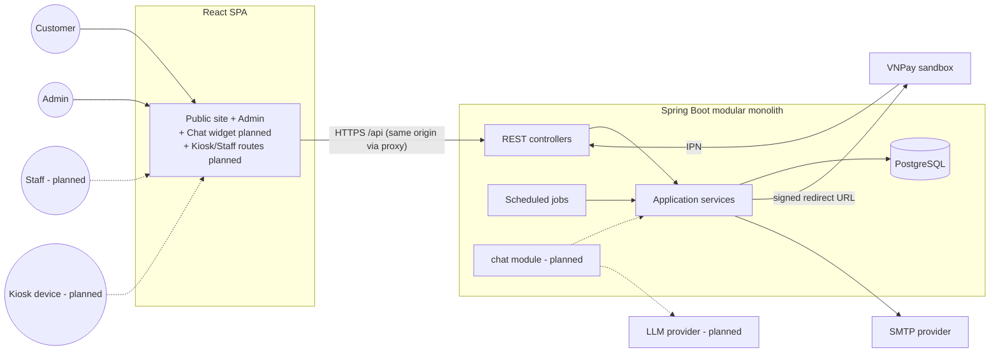
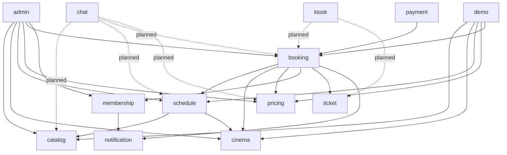
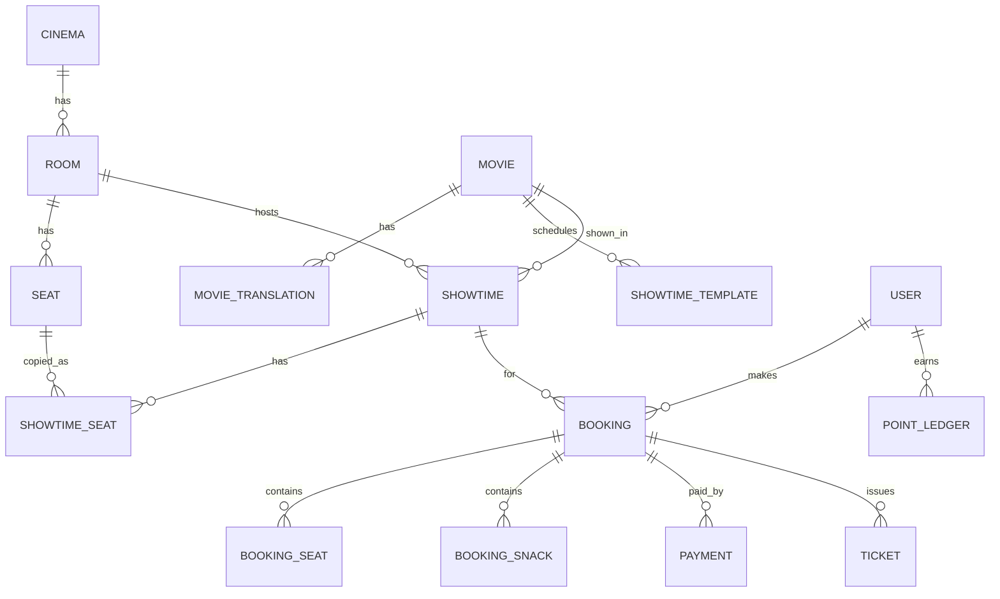
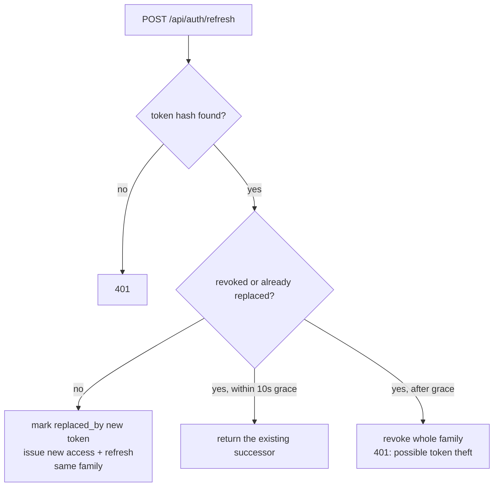
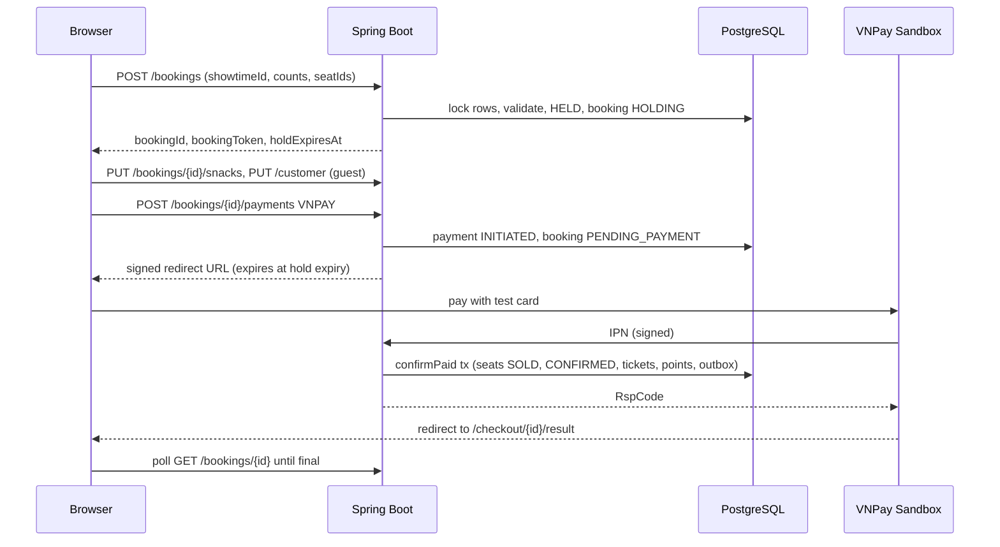
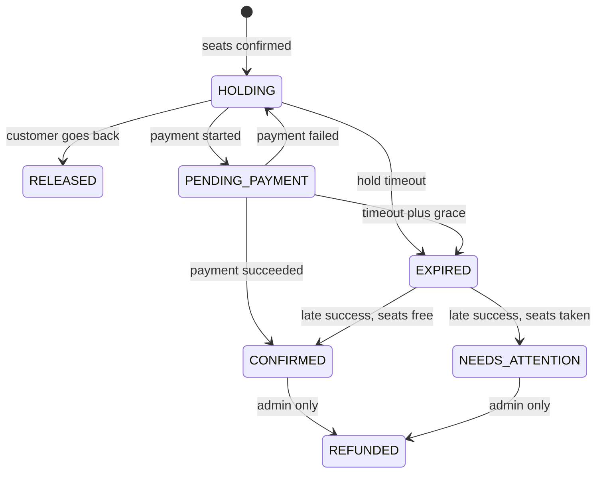
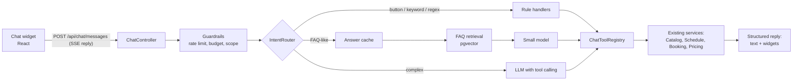
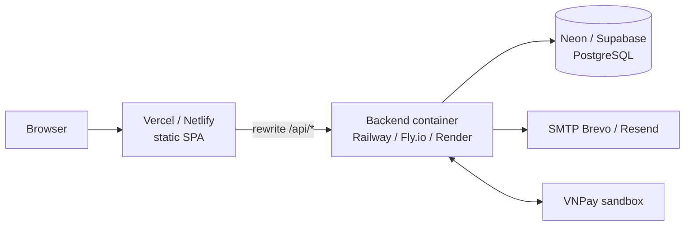

# CineBot – Architecture

| Item | Value |
| --- | --- |
| Status | v1.0 – target architecture (implementation not started) |
| Last updated | 2026-11-11 |
| Related | `PRD.md` (scope), `RULES.md` (BR/ER rules), `DESIGN.md` (UI), `PROGRESS.md` (status) |

---

## 1. Principles

1. **Modular monolith.** One Spring Boot application split into feature modules. It is simple to run, deploy and explain, and modules can be extracted later if ever needed.
2. **One set of use cases, many channels.** Web, chatbot and kiosk call the same application services (`ER-01`). Channels differ only in presentation.
3. **The database guards the invariants.** Primary keys, exclusion constraints and row locks make double booking impossible, not just unlikely (`ER-09`, `ER-10`).
4. **Server is the authority** for prices, availability and rules (`ER-03`).
5. **Testable time.** An injected `Clock` drives holds, the rolling window and VIP expiry (`ER-06`).
6. **Demo-first operations.** Self-healing data (rolling showtimes, nightly reset) keeps the public demo usable without maintenance.

## 2. Technology Stack

| Layer | Choice | Notes |
| --- | --- | --- |
| Backend language/runtime | Java 21 (LTS) | |
| Framework | Spring Boot (latest stable at project start) | Web, Validation, Data JPA, Security, OAuth2 Resource Server (JWT), Mail, Actuator |
| Build | Maven | |
| Database | PostgreSQL 16 | Extensions: `btree_gist`, `pgcrypto` |
| Migrations | Flyway | `ddl-auto=validate` (`ER-07`) |
| Mapping | MapStruct | Lombok optional |
| API docs | springdoc-openapi | Swagger UI at `/swagger-ui` |
| Rate limiting | Bucket4j (in-memory) | Replace with Redis-backed if scaled out |
| QR codes | ZXing | |
| Email | Spring Mail + Thymeleaf | Outbox pattern |
| Tests | JUnit 5, AssertJ, MockMvc, Testcontainers | |
| Frontend | Vite, React 18, TypeScript, Tailwind v4, shadcn/ui | From the existing prototype |
| Frontend data | TanStack Query, Zustand, axios, react-i18next, react-hook-form + zod | |
| Frontend tests | Vitest (+ Playwright optional) | |
| CI | GitHub Actions | Backend tests with Testcontainers, frontend lint/typecheck/test/build |

## 3. System Context



## 4. Backend Structure

### 4.1 Modules

```
com.cinebot
├── common        config, security, error handling (ProblemDetail), i18n, Clock, ids, rate limiting
├── auth          register, login, refresh rotation, logout
├── user          profile, my bookings
├── catalog       movies, translations, genres, credits
├── cinema        cinema, rooms, seats, layout generator
├── schedule      showtimes, templates, rolling generator, simulated occupancy
├── pricing       pricing policies, PriceCalculator
├── booking       holds, OrphanSeatRule, snacks, customer info, lookup, hold expiry
├── payment       PaymentGateway (VNPay, Mock), IPN, reconciliation
├── ticket        ticket issuing, QR tokens            (check-in added later)
├── membership    point ledger, VIP evaluation
├── notification  email outbox, templates
├── admin         admin-only controllers, dashboard queries, audit log
├── demo          seed loader, nightly reset
├── chat          (planned)  intent router, tools, FAQ retrieval, LLM gateway, budget
└── kiosk         (planned)  device auth, lookup, printing; checkin (staff)
```

### 4.2 Layers inside a module

```
<module>/
  api/          @RestController, request/response DTOs, DTO mappers      (HTTP only)
  application/  services = use cases, commands, results, transactions    (business logic)
  domain/       entities, value objects, domain rules (e.g. OrphanSeatRule, PriceCalculator)
  infra/        repositories, native queries, external clients (VNPay, SMTP)
```

- Controllers call application services only.
- Application services own transactions (`@Transactional`) and call other modules only through their **application service interfaces** (`ER-02`).
- Domain rules are plain Java with no Spring dependencies, so they can be unit-tested directly.

### 4.3 Module dependencies (allowed direction)



`payment` confirms a booking by calling `BookingService.confirmPaid(...)`. Inside that transaction the booking module calls `ticket` (issue tickets), `membership` (earn points) and `notification` (enqueue email). There are no cyclic dependencies.

## 5. Data Model

### 5.1 Entity overview



### 5.2 Tables (v1)

Conventions: `BIGSERIAL` ids (bookings use `UUID`), `created_at` / `updated_at timestamptz`, enums as `text` + `CHECK` (`ER-08`).

**Identity**
```
users            id, email UNIQUE, password_hash, full_name, phone,
                 role CHECK (CUSTOMER|STAFF|ADMIN),         -- STAFF reserved for check-in
                 preferred_locale, vip_since, vip_until, is_seed, created_at
refresh_tokens   id, user_id FK, token_hash UNIQUE, family_id uuid, expires_at,
                 revoked_at, replaced_by_id, created_ip, user_agent, created_at
```

**Cinema**
```
cinemas          id, name, address, phone, timezone               -- 1 row in v1
rooms            id, cinema_id FK, name, cleanup_minutes DEFAULT 15, is_active, is_seed
seats            id, room_id FK, row_label, seat_number, col_index,
                 seat_type CHECK (SINGLE|COUPLE), is_active,
                 UNIQUE (room_id, row_label, seat_number)
```

**Catalogue**
```
movies               id, slug UNIQUE, original_title, duration_min,
                     age_rating CHECK (P|K|T13|T16|T18), country_code,
                     audio_language, subtitle_language, release_date, release_offset_days,
                     status CHECK (NOW_SHOWING|COMING_SOON|ENDED),
                     poster_url, backdrop_url, trailer_youtube_id, is_seed
movie_translations   movie_id FK, locale, title, synopsis, PK (movie_id, locale)
genres               id, code UNIQUE
genre_translations   genre_id FK, locale, name, PK (genre_id, locale)
movie_genres         movie_id FK, genre_id FK, PK (movie_id, genre_id)
movie_credits        id, movie_id FK, role CHECK (DIRECTOR|CAST), person_name, sort_order
```

**Schedule**
```
showtime_templates   id, movie_id FK, room_id FK, start_time time,
                     days_of_week smallint,           -- bitmask, bit0 = Monday
                     active, is_seed
showtimes            id, movie_id FK, room_id FK, starts_at, ends_at, blocked_until,
                     status CHECK (SCHEDULED|CANCELLED),
                     source CHECK (TEMPLATE|MANUAL), template_id NULL,
                     UNIQUE (room_id, starts_at),
                     EXCLUDE USING gist (room_id WITH =, tstzrange(starts_at, blocked_until) WITH &&)
                       WHERE (status <> 'CANCELLED')
showtime_seats       showtime_id FK, seat_id FK,
                     status CHECK (AVAILABLE|HELD|SOLD|BLOCKED),
                     booking_id uuid NULL, hold_expires_at NULL,
                     PRIMARY KEY (showtime_id, seat_id)
```

**Pricing and snacks**
```
pricing_policies     id, effective_from, discount_day_of_week,
                     adult_discount_day, adult_weekday, adult_weekend,
                     student_price, couple_surcharge,
                     points_rate_pct, vip_threshold_points, vip_snack_discount_pct,
                     hold_minutes, created_by
snacks               id, code UNIQUE, price, image_url, is_combo, active, sort_order, is_seed
snack_translations   snack_id FK, locale, name, description, PK (snack_id, locale)
```

**Booking, payment, tickets**
```
bookings         id uuid, code UNIQUE,                 -- 8 chars Crockford base32
                 showtime_id FK, user_id NULL FK,
                 channel CHECK (WEB|CHAT|KIOSK|ADMIN) DEFAULT 'WEB',     -- ER-04
                 access_token_hash, status (see BR-12), hold_expires_at,
                 customer_name, customer_phone, customer_email, locale,
                 ticket_subtotal, snack_subtotal, snack_discount, total,
                 points_earned, created_at, confirmed_at
booking_seats    booking_id FK, seat_id FK, ticket_type CHECK (ADULT|STUDENT|COUPLE),
                 unit_price, PK (booking_id, seat_id)
booking_snacks   booking_id FK, snack_id FK, quantity, unit_price, discount_pct
payments         id, booking_id FK, provider CHECK (VNPAY|MOCK), txn_ref UNIQUE, amount,
                 status CHECK (INITIATED|SUCCEEDED|FAILED|EXPIRED),
                 provider_txn_no, raw_response jsonb, created_at, completed_at
tickets          id, booking_id FK, seat_id FK, ticket_type, admits smallint,
                 qr_token UNIQUE, status CHECK (VALID|CHECKED_IN|VOID),
                 checked_in_at NULL                                       -- used by check-in later
```

**Membership and operations**
```
point_ledger     id, user_id FK, booking_id NULL FK, points,
                 type CHECK (EARN|REVERSAL|ADJUST), earned_at, expires_at
email_outbox     id, type, payload jsonb, status CHECK (PENDING|SENT|FAILED),
                 attempts, next_attempt_at, last_error
audit_log        id, actor_user_id, action, entity_type, entity_id, changes jsonb, created_at
```

### 5.3 Indexes

`showtimes (movie_id, starts_at)`, `showtimes (room_id, starts_at)`, `showtime_seats (booking_id)`, partial `showtime_seats (hold_expires_at) WHERE status = 'HELD'`, `bookings (user_id, created_at DESC)`, `bookings (status, hold_expires_at)`, `point_ledger (user_id, earned_at)`, `payments (status, created_at)`.

### 5.4 Size estimate

5 rooms × ~5 showtimes/day × 7 days × ~130 seats ≈ **23k `showtime_seats` rows** in the rolling window. Older rows are purged by the nightly reset (`BR-26`).

### 5.5 Seed layouts (5 rooms)

| Room | Single rows × seats | Couple row × seats | People |
| --- | --- | --- | --- |
| Room 1 | A–J: 10 × 16 | K: 8 | 176 |
| Room 2 | A–I: 9 × 14 | J: 7 | 140 |
| Room 3 | A–H: 8 × 12 | I: 6 | 108 |
| Room 4 | A–H: 8 × 12 | I: 6 | 108 |
| Room 5 | A–F: 6 × 10 | G: 5 | 70 |

## 6. Concurrency and Consistency

### 6.1 Creating a hold (`BookingService.createHold`)

One transaction (READ COMMITTED):

```sql
-- 1. Lock all seats in the rows touched by the request, in a fixed order (ER-10).
SELECT ss.seat_id, ss.status, ss.booking_id, ss.hold_expires_at
FROM showtime_seats ss JOIN seats s ON s.id = ss.seat_id
WHERE ss.showtime_id = :showtimeId AND s.row_label IN (:rowLabels)
ORDER BY ss.seat_id
FOR UPDATE OF ss;
```

2. In Java, on the locked rows:
   - treat expired holds as available;
   - verify that the showtime is open for sale (`BR-24`), the counts are valid (`BR-05`, `BR-07`), every requested seat is available, and the orphan rule passes per row (`BR-08`);
   - release the caller's previous active hold (`BR-10`);
   - compute and snapshot prices (`BR-04`, `BR-19`).
3. Take the seats and create the booking:

```sql
UPDATE showtime_seats
SET status = 'HELD', booking_id = :bookingId, hold_expires_at = :expiresAt
WHERE showtime_id = :showtimeId AND seat_id IN (:seatIds);
```

The whole row is locked because the orphan rule depends on neighbours. Two customers picking A3 and A5 at the same time are serialized, so the second sees the first's hold and is rejected. Rows hold at most about 16 seats, so contention is negligible.

### 6.2 Confirming after payment (`BookingService.confirmPaid`)

```sql
UPDATE showtime_seats SET status = 'SOLD', hold_expires_at = NULL
WHERE showtime_id = :showtimeId AND booking_id = :bookingId AND status = 'HELD';
```

If the updated row count is not equal to the booking's seat count, the hold was lost. The service then follows `BR-14`: it locks the rows as in 6.1, re-takes the seats if they are free, and otherwise sets `NEEDS_ATTENTION`.

In the same transaction: mark the payment `SUCCEEDED`, the booking `CONFIRMED`, issue tickets, earn points, and enqueue the email.

**Idempotency:** the IPN handler first loads the payment `FOR UPDATE`. If it is already `SUCCEEDED`, it returns the "already confirmed" response without side effects.

### 6.3 Expiry

- **Lazy:** every query treats `HELD AND hold_expires_at < now()` as available. Correctness never depends on the job.
- **Job `HoldExpiryJob` (every 30 s):** releases expired seats and marks bookings `EXPIRED`. It applies the 2-minute grace period to `PENDING_PAYMENT` bookings (`BR-11`).

### 6.4 Seat map freshness

- v1: clients poll `GET /api/showtimes/{id}/seat-map` every 5 s while the seat map is visible, and always after a `409`.
- Planned: SSE stream `GET /api/showtimes/{id}/seat-events` (§10.1). `BookingService` already publishes Spring application events (`SeatsHeld`, `SeatsReleased`, `SeatsSold`) in v1, so adding SSE later only needs a listener and an endpoint.

## 7. Authentication and Authorization

### 7.1 Tokens

| Token | Lifetime | Client storage | Server storage |
| --- | --- | --- | --- |
| Access (JWT HS256, claims `sub`, `role`, `exp`, `jti`) | 15 min | Memory only | None |
| Refresh (opaque, 256-bit) | 7 days | Cookie `HttpOnly; Secure; SameSite=Strict; Path=/api/auth` | SHA-256 hash in `refresh_tokens` |

### 7.2 Refresh rotation with reuse detection



- Login creates a new family. Logout revokes the family.
- The frontend runs a single-flight refresh (one refresh call shared by concurrent requests) and calls `/refresh` once on application start.
- CSRF: the cookie is scoped to `/api/auth`, and those endpoints require the `X-Requested-With` header plus an allow-listed `Origin`.
- **Same-site requirement:** the frontend must reach the API on the same site (Vercel rewrite `/api/*` or one custom domain). Otherwise browsers block the cookie as third-party.

### 7.3 Booking access (guest and member)

`POST /api/bookings` returns a random `bookingToken`. The server stores `access_token_hash`, and every booking-scoped endpoint requires `X-Booking-Token`. Members are additionally authorized by `user_id`. The same mechanism lets the **chat hand a booking to the checkout page** and lets a **kiosk act on a booking** without a user session.

### 7.4 Authorization matrix

| Endpoint group | Public | Booking token | CUSTOMER | STAFF (planned) | ADMIN | KIOSK device (planned) |
| --- | --- | --- | --- | --- | --- | --- |
| Catalogue, showtimes, seat map, snacks | ✅ | | | | | |
| Booking-scoped calls | | ✅ | ✅ own | | ✅ | |
| `/api/me/**` | | | ✅ | | | |
| `/api/admin/**` | | | | | ✅ | |
| `/api/staff/**` | | | | ✅ | ✅ | |
| `/api/kiosk/**` | | | | | | ✅ |

## 8. Key Flows and Jobs

### 8.1 Booking and payment



### 8.2 Booking state machine



### 8.3 Payment gateways

```java
public interface PaymentGateway {
    PaymentProvider provider();                                        // VNPAY, MOCK
    PaymentInitResult initiate(Payment payment, Booking booking, Instant expiresAt);
    CallbackVerification verifyCallback(Map<String, String> params);  // signature + parsing
    Optional<ProviderStatus> query(Payment payment);                  // reconciliation
}
```

- **VNPay:** HMAC-SHA512 checksum, `vnp_Amount = total × 100`, `vnp_ExpireDate = hold expiry`, `vnp_TxnRef = payments.txn_ref`. The IPN is the source of truth; the return URL only verifies and redirects.
- **Mock (Demo Pay):** `initiate` returns `/pay/mock/{paymentId}`. Its page calls `POST /api/payments/mock/{paymentId}`, which runs the same confirmation path as an IPN.
- **`PaymentReconciliationJob` (every 1 min):** queries `INITIATED` VNPay payments older than 1 minute. This covers local development without a public IPN URL, and lost IPNs.

### 8.4 Scheduled jobs

| Job | Schedule (cinema time) | Purpose |
| --- | --- | --- |
| `HoldExpiryJob` | every 30 s | Release expired holds (`BR-11`) |
| `PaymentReconciliationJob` | every 1 min | Resolve pending VNPay payments |
| `EmailOutboxJob` | every 30 s | Send emails with retry/backoff |
| `RollingShowtimeJob` | 00:05 daily + startup + lazy guard | Keep 7 days of showtimes (`BR-25`) |
| `VipEvaluationJob` | 01:00 daily | Renew or lapse VIP (`BR-18`) |
| `DemoResetJob` | 03:00 daily | Restore seed data, purge old data (`BR-26`) |

The lazy guard is needed because free hosting may sleep at midnight. `CatalogService` checks "has the window been generated for today?" on the first request of a day and triggers generation if not. If the app ever runs with more than one instance, add ShedLock.

## 9. API

### 9.1 Endpoint catalogue

**Public**
```
GET  /api/movies?status=&genre=
GET  /api/movies/{slug}
GET  /api/movies/{slug}/showtimes?from=&days=
GET  /api/showtimes/{id}
GET  /api/showtimes/{id}/seat-map
GET  /api/snacks
GET  /api/cinema
```

**Booking** (booking token or owner)
```
POST   /api/bookings
GET    /api/bookings/{id}
PUT    /api/bookings/{id}/snacks
PUT    /api/bookings/{id}/customer
DELETE /api/bookings/{id}
POST   /api/bookings/{id}/payments
GET    /api/bookings/{id}/tickets
POST   /api/bookings/lookup
```

**Payments**
```
GET  /api/payments/vnpay/ipn
GET  /api/payments/vnpay/return
POST /api/payments/mock/{paymentId}
```

**Auth and account**
```
POST /api/auth/register | login | refresh | logout
GET|PUT /api/me
GET  /api/me/bookings
GET  /api/me/membership
```

**Admin**
```
/api/admin/dashboard | movies | rooms | showtimes | showtime-templates
/api/admin/pricing | snacks | bookings | audit-log
```

### 9.2 Error codes (`ER-05`)

| HTTP | Code | When |
| --- | --- | --- |
| 400 | `VALIDATION_FAILED` | Bean Validation errors (with field details) |
| 401 | `UNAUTHENTICATED`, `TOKEN_REUSED` | Missing or expired token; refresh token reuse |
| 403 | `FORBIDDEN`, `BOOKING_TOKEN_INVALID` | Wrong role; wrong or missing booking token |
| 404 | `NOT_FOUND` | |
| 409 | `SEAT_UNAVAILABLE` | Seats taken (response lists the seat ids) |
| 409 | `SHOWTIME_OVERLAP` | Admin creates an overlapping showtime |
| 409 | `INVALID_STATE` | Action not allowed in the current booking state |
| 410 | `HOLD_EXPIRED` | Booking hold has expired |
| 422 | `ORPHAN_SEAT` | `BR-08` violated (response lists the orphan seat ids) |
| 422 | `TICKET_COUNT_MISMATCH`, `BOOKING_TOO_LARGE`, `SALES_CLOSED`, `NOT_BOOKABLE` | `BR-05`, `BR-07`, `BR-24`, `BR-23` |
| 422 | `SEED_PROTECTED` | Deleting seed data (`BR-26`) |
| 429 | `RATE_LIMITED` | |

### 9.3 Localisation

The `Accept-Language` header (`vi`/`en`) selects translations, with a fallback to `vi`. Emails use `bookings.locale`. Error codes are translated on the client.

## 10. Extension Points for Planned Modules

v1 deliberately includes the following hooks so the chatbot and the kiosk can be added **without changing existing tables or breaking existing APIs**:

| Hook in v1 | Used by |
| --- | --- |
| Channel-agnostic application services (`ER-01`) | Chat tools, kiosk endpoints |
| `bookings.channel` | Chat (`CHAT`), kiosk walk-up sales (`KIOSK`) |
| Booking token (§7.3) | Chat → checkout handoff, kiosk acting on a booking |
| Domain events `SeatsHeld/Released/Sold` | SSE seat stream for chat and seat map |
| Error codes instead of messages (`ER-05`) | Chat phrases errors conversationally; kiosk shows short messages |
| `tickets.qr_token`, `tickets.status`, `tickets.checked_in_at`, `admits` | Check-in |
| `users.role` already allows `STAFF` | Staff check-in |
| Presentational booking components (`ER-17`) | Chat widgets, kiosk screens |
| `OrphanSeatRule` as a pure domain class | Seat suggestion algorithm |

### 10.1 Chatbot module (planned)



**New tables (future migration):**
```
chat_sessions      id uuid, user_id NULL, locale, created_at, last_active_at, ip_hash
chat_messages      id, session_id FK, role (USER|ASSISTANT|TOOL), content, widgets jsonb,
                   intent, engine (RULE|CACHE|FAQ|LLM), tokens_in, tokens_out, cost_micros, created_at
faq_entries        id, code, active, is_seed  + faq_translations (faq_id, locale, question, answer)
faq_embeddings     faq_id, locale, embedding vector(…)        -- pgvector extension
llm_usage_daily    date, tokens_in, tokens_out, cost_micros    -- budget cap
```

**Tools exposed to the LLM.** Each tool is a thin adapter over an existing application service:

| Tool | Service call |
| --- | --- |
| `search_movies(genre, status, date, timeOfDay, ageMax)` | `CatalogService.search` |
| `get_movie(slug)` | `CatalogService.getDetail` |
| `list_showtimes(movie, date, timeOfDay)` | `ScheduleService.listShowtimes` |
| `get_seat_map(showtimeId)` | `BookingQueryService.seatMap` |
| `suggest_seats(showtimeId, adult, student, couple)` | `SeatSuggestionService.suggest` (new; uses `OrphanSeatRule`) |
| `quote_price(showtimeId, counts)` | `PriceCalculator` |
| `search_faq(query)` | `FaqService.search` |
| `lookup_booking(code, emailOrPhone)` | `BookingService.lookup` |

Holds and payment are **not** LLM tools. They are triggered by widget buttons that call the normal booking API (`BR-C-02`). The chat reply format is `{ text, widgets: [{type: "movie_cards" | "showtimes" | "ticket_counter" | "seat_map" | "snack_picker" | "checkout_link", data}] }`. The widget renders these with the v1 presentational components.

**LLM gateway.** `LlmClient` interface (provider-agnostic), with the system prompt in resources, prompt caching, `max_tokens` limits, and the last N turns plus a summary as context.

### 10.2 Kiosk and staff check-in modules (planned)

**New tables (future migration):**
```
kiosk_devices    id, name, token_hash UNIQUE, active, last_seen_at, created_by
ticket_events    id, ticket_id FK, type (PRINTED|REPRINTED|CHECKED_IN|CHECKIN_REJECTED|VOIDED),
                 actor_type (KIOSK|STAFF|ADMIN), actor_id, reason, created_at
```

**Endpoints:**
```
POST /api/kiosk/lookup                      {code | qrToken, phoneLast4}   (device token)
POST /api/kiosk/bookings/{code}/print       -> printable ticket data, logs PRINTED/REPRINTED
POST /api/staff/checkin                     {qrToken | code}               (STAFF)
GET  /api/staff/showtimes/{id}/attendance
```

**Check-in transaction:** `SELECT ticket FOR UPDATE` → validate `BR-K-05` → set `status = CHECKED_IN`, `checked_in_at`, insert a `ticket_events` row. A re-scan inserts `CHECKIN_REJECTED` and returns the original check-in time.

**Frontend:** separate lazy-loaded route trees `/kiosk/*` (full-screen layout, no navigation) and `/staff/*` (mobile-first scanner). Both reuse `features/booking` and `features/checkout` ticket components (`DESIGN.md` §11).

## 11. Frontend Architecture

```
src/
  app/               router, providers (QueryClient, i18n, auth), layouts (Public, Admin; later Kiosk, Staff)
  pages/             route components (thin: compose features, read params)
  features/          movies, showtimes, booking, checkout, auth, membership, admin/*; later chat, kiosk
  components/ui/     shadcn components (from the prototype)
  components/layout/ Nav, Footer, LanguageSwitcher, AdminSidebar
  lib/               api client (axios + refresh interceptor + booking-token header), money, dates, errors→i18n
  i18n/              vi.json, en.json
  styles/            theme.css (design tokens), fonts.css, tailwind.css
```

- **API client:** attaches `Authorization`, `Accept-Language`, `X-Booking-Token` (when the URL is booking-scoped) and `X-Requested-With`. On 401 it performs one shared refresh and retries once.
- **Booking store (Zustand, persisted in `sessionStorage`):** `showtimeId`, counts, selected seats, `bookingId`, `bookingToken`, `holdExpiresAt`. It survives reloads and language switches (`FR-I18N-03`).
- **Code splitting:** admin, and later kiosk, staff and chat widget, are lazy-loaded so the public bundle stays small.

## 12. Configuration

| Variable | Purpose |
| --- | --- |
| `DB_URL`, `DB_USER`, `DB_PASSWORD` | PostgreSQL |
| `JWT_SECRET` | HS256 key (≥ 256 bits) |
| `APP_PUBLIC_URL`, `API_PUBLIC_URL` | Redirect and return URLs, CORS |
| `VNPAY_TMN_CODE`, `VNPAY_HASH_SECRET`, `VNPAY_PAY_URL`, `VNPAY_QUERY_URL` | Sandbox credentials |
| `PAYMENT_PROVIDERS_ENABLED` | e.g. `VNPAY,MOCK` |
| `MAIL_HOST`, `MAIL_PORT`, `MAIL_USERNAME`, `MAIL_PASSWORD`, `MAIL_FROM` | SMTP |
| `CINEMA_TIMEZONE` | Default `Asia/Ho_Chi_Minh` |
| `DEMO_MODE` | Enables seed protection, nightly reset, simulated occupancy |
| *(planned)* `LLM_PROVIDER`, `LLM_API_KEY`, `CHAT_DAILY_BUDGET_USD` | Chatbot |

Business values (prices, hold minutes, VIP threshold…) live in `pricing_policies`, not in environment variables, so admin can change them (`[Config]` in `RULES.md`).

Profiles: `local` (Docker Compose DB, Mock payment by default), `test` (Testcontainers), `prod`.

## 13. Testing Strategy

| Level | Scope |
| --- | --- |
| Domain unit tests | `OrphanSeatRule` (shared fixture `orphan-rule-cases.json`, `ER-20`), `PriceCalculator`, VIP evaluation, VNPay signing |
| Service integration (Testcontainers) | Concurrent holds (20 threads, 1 winner), neighbouring-seat race, duplicate IPN, late IPN (both branches), overlap constraint, rolling generator idempotency, refresh-token reuse |
| Web layer (MockMvc) | Auth rules, booking token, admin role, error code mapping |
| Frontend (Vitest) | Orphan rule with the same fixture, price display, booking store, API error mapping |
| E2E (optional, Playwright) | Guest booking with Demo Pay; member checkout skips step 1 |

## 14. Deployment



- The backend is built as a Docker image (multi-stage Maven → JRE 21) and checked with `/actuator/health`.
- Prefer hosting that does not sleep. If the host sleeps, the lazy guard (§8.4) keeps data correct, but the first request will be slow.
- VNPay sandbox IPN URL: `https://<frontend-domain>/api/payments/vnpay/ipn`.

## 15. Architecture Decision Records (summary)

| ADR | Decision | Rationale |
| --- | --- | --- |
| 001 | Modular monolith, package-by-feature | Small team, one deployable unit, clear boundaries for future chat/kiosk |
| 002 | PostgreSQL row locks for seat holds, no Redis | One source of truth, transactional with bookings, fewer moving parts |
| 003 | Per-showtime seat rows (`showtime_seats`) | Simple and fast availability, natural lock target, primary key prevents double sale |
| 004 | Hold on seat confirmation, 10 min | Avoids lock spam and last-step seat loss (`BR-09`) |
| 005 | IPN-only confirmation + reconciliation | Browser redirects are not trustworthy |
| 006 | JWT access + rotating refresh with reuse detection | Stateless API with revocable sessions |
| 007 | Booking token for booking-scoped access | Supports guests, chat handoff and kiosk uniformly |
| 008 | Rolling templates + nightly reset | Demo is always alive and admin features stay real |
| 009 | Error codes, client-side translation | One API for web, chat and kiosk in two languages |
