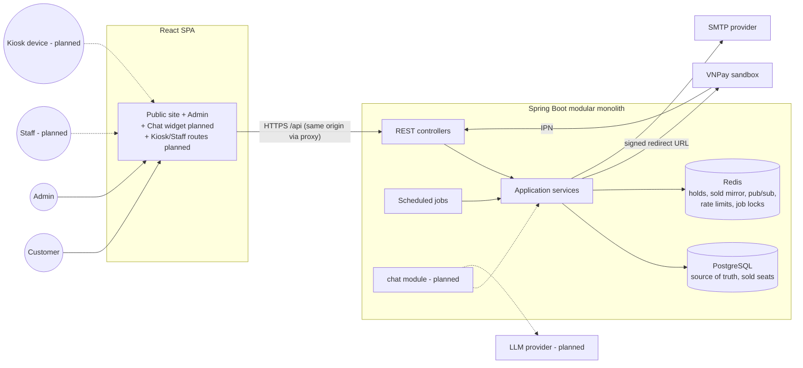
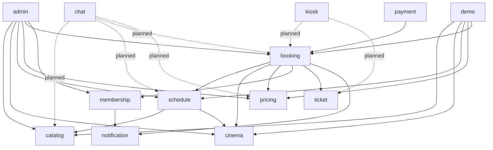
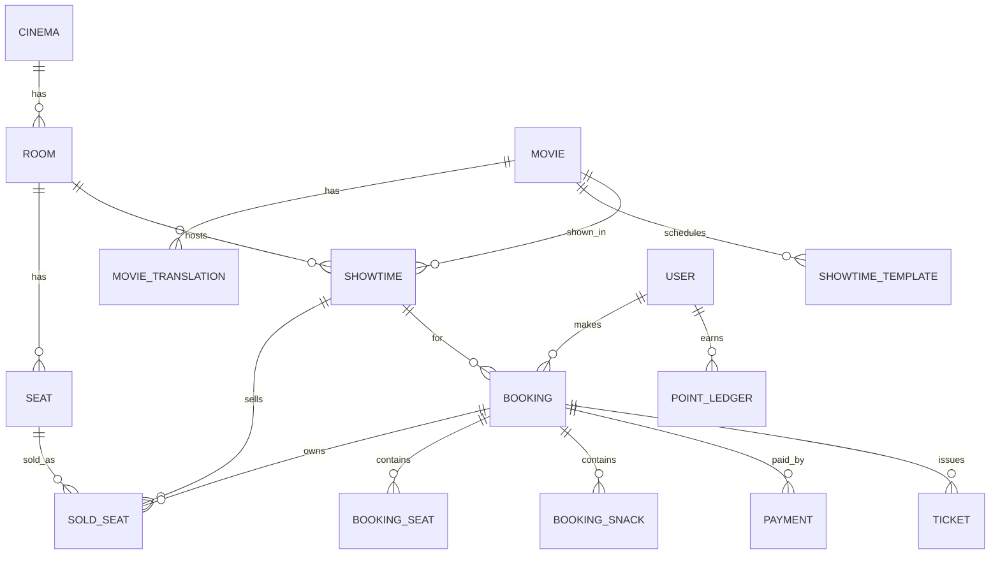
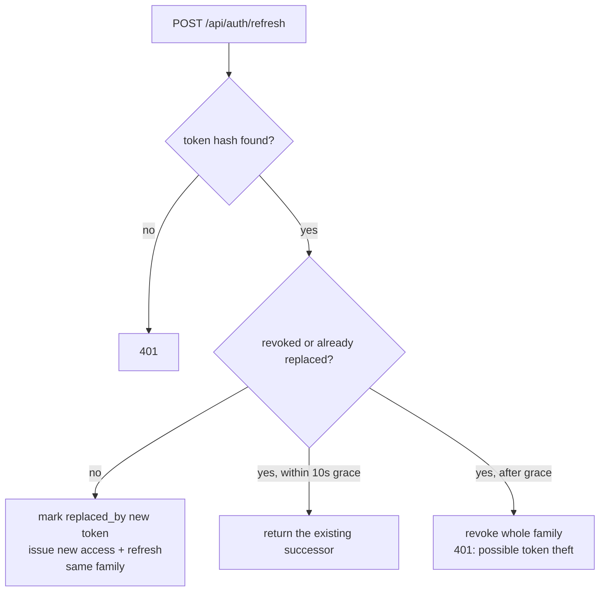
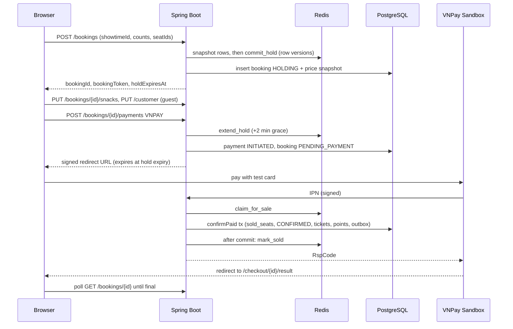
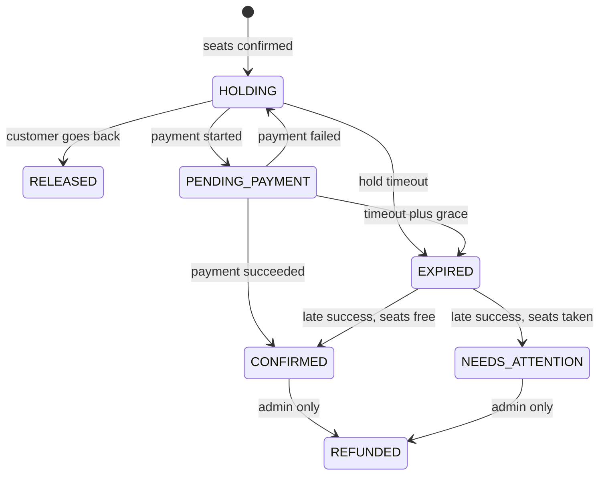
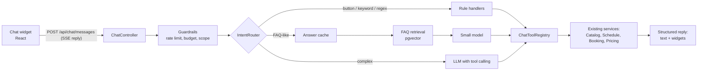
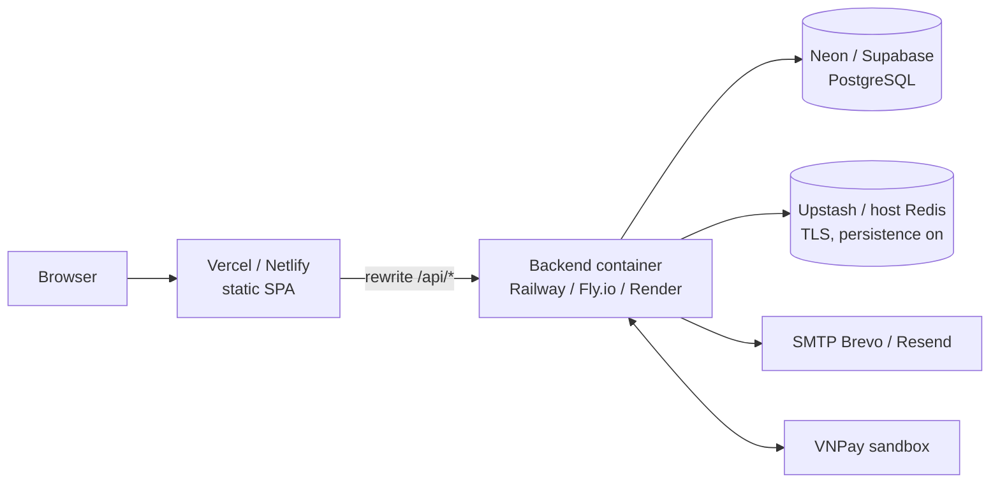

# CineBot – Architecture

| Item | Value |
| --- | --- |
| Status | v1.1 – target architecture with Redis seat holds (implementation not started) |
| Last updated | 2026-11-11 |
| Related | `PRD.md` (scope), `RULES.md` (BR/ER rules), `DESIGN.md` (UI), `PROGRESS.md` (status) |

---

## 1. Principles

1. **Modular monolith.** One Spring Boot application split into feature modules. It is simple to run, deploy and explain, and modules can be extracted later if ever needed.
2. **One set of use cases, many channels.** Web, chatbot and kiosk call the same application services (`ER-01`). Channels differ only in presentation.
3. **Two stores, clear ownership.** Redis owns temporary **holds**. PostgreSQL owns **sales** and is the final guarantee: the `sold_seats` primary key makes double selling impossible even if Redis loses data (`ER-09`, `ER-10`).
4. **Server is the authority** for prices, availability and rules (`ER-03`).
5. **Testable time.** An injected `Clock` drives holds, the rolling window and VIP expiry (`ER-06`).
6. **Demo-first operations.** Self-healing data (rolling showtimes, nightly reset) keeps the public demo usable without maintenance.

## 2. Technology Stack

| Layer | Choice | Notes |
| --- | --- | --- |
| Backend language/runtime | Java 21 (LTS) | |
| Framework | Spring Boot (latest stable at project start) | Web, Validation, Data JPA, Security, OAuth2 Resource Server (JWT), Mail, Actuator |
| Build | Maven | |
| Database | PostgreSQL 16 | Extensions: `btree_gist`, `pgcrypto` |
| In-memory store | Redis 7 (Spring Data Redis, Lettuce) | Seat holds (Lua scripts), sold-seat mirror, pub/sub, rate limits, ShedLock, catalogue cache |
| Migrations | Flyway | `ddl-auto=validate` (`ER-07`) |
| Mapping | MapStruct | Lombok optional |
| API docs | springdoc-openapi | Swagger UI at `/swagger-ui` |
| Rate limiting | Bucket4j (Redis / Lettuce backend) | Works across instances |
| Job locking | ShedLock (Redis provider) | Each scheduled job runs once even with several instances |
| QR codes | ZXing | |
| Email | Spring Mail + Thymeleaf | Outbox pattern |
| Tests | JUnit 5, AssertJ, MockMvc, Testcontainers | |
| Frontend | Vite, React 18, TypeScript, Tailwind v4, shadcn/ui | From the existing prototype |
| Frontend data | TanStack Query, Zustand, axios, react-i18next, react-hook-form + zod | |
| Frontend tests | Vitest (+ Playwright optional) | |
| CI | GitHub Actions | Backend tests with Testcontainers, frontend lint/typecheck/test/build |

## 3. System Context



## 4. Backend Structure

### 4.1 Modules

```
com.cinebot
├── common        config, security, error handling (ProblemDetail), i18n, Clock, ids, rate limiting
├── auth          register, login, refresh rotation, logout
├── user          profile, my bookings
├── catalog       movies, translations, genres, credits
├── cinema        cinema, rooms, seats, layout generator
├── schedule      showtimes, templates, rolling generator, simulated occupancy
├── pricing       pricing policies, PriceCalculator
├── booking       SeatInventory (Redis + Lua), holds, OrphanSeatRule, snacks, customer info, lookup, hold expiry
├── payment       PaymentGateway (VNPay, Mock), IPN, reconciliation
├── ticket        ticket issuing, QR tokens            (check-in added later)
├── membership    point ledger, VIP evaluation
├── notification  email outbox, templates
├── admin         admin-only controllers, dashboard queries, audit log
├── demo          seed loader, nightly reset
├── chat          (planned)  intent router, tools, FAQ retrieval, LLM gateway, budget
└── kiosk         (planned)  device auth, lookup, printing; checkin (staff)
```

### 4.2 Layers inside a module

```
<module>/
  api/          @RestController, request/response DTOs, DTO mappers      (HTTP only)
  application/  services = use cases, commands, results, transactions    (business logic)
  domain/       entities, value objects, domain rules (e.g. OrphanSeatRule, PriceCalculator)
  infra/        repositories, native queries, external clients (VNPay, SMTP)
```

- Controllers call application services only.
- Application services own transactions (`@Transactional`) and call other modules only through their **application service interfaces** (`ER-02`).
- Domain rules are plain Java with no Spring dependencies, so they can be unit-tested directly.

### 4.3 Module dependencies (allowed direction)



`payment` confirms a booking by calling `BookingService.confirmPaid(...)`. Inside that transaction the booking module calls `ticket` (issue tickets), `membership` (earn points) and `notification` (enqueue email). There are no cyclic dependencies.

## 5. Data Model

### 5.1 Entity overview



### 5.2 Tables (v1)

Conventions: `BIGSERIAL` ids (bookings use `UUID`), `created_at` / `updated_at timestamptz`, enums as `text` + `CHECK` (`ER-08`).

**Identity**
```
users            id, email UNIQUE, password_hash, full_name, phone,
                 role CHECK (CUSTOMER|STAFF|ADMIN),         -- STAFF reserved for check-in
                 preferred_locale, vip_since, vip_until, is_seed, created_at
                 -- vip_since = current VIP period start (NULL after a lapse); vip_until kept as history (BR-18)
refresh_tokens   id, user_id FK, token_hash UNIQUE, family_id uuid, expires_at,
                 revoked_at, replaced_by_id, created_ip, user_agent, created_at
```

**Cinema**
```
cinemas          id, name, address, phone, timezone               -- 1 row in v1
rooms            id, cinema_id FK, name, cleanup_minutes DEFAULT 15, is_active, is_seed
seats            id, room_id FK, row_label, seat_number, col_index,
                 seat_type CHECK (SINGLE|COUPLE),
                 is_active,                        -- false = blocked (not sellable in future holds)
                 UNIQUE (room_id, row_label, seat_number)
```

**Catalogue**
```
movies               id, slug UNIQUE, original_title, duration_min,
                     age_rating CHECK (P|K|T13|T16|T18), country_code,
                     audio_language, subtitle_language, release_date, release_offset_days,
                     status CHECK (NOW_SHOWING|COMING_SOON|ENDED),
                     poster_url, backdrop_url, trailer_youtube_id, is_seed
movie_translations   movie_id FK, locale, title, synopsis, PK (movie_id, locale)
genres               id, code UNIQUE
genre_translations   genre_id FK, locale, name, PK (genre_id, locale)
movie_genres         movie_id FK, genre_id FK, PK (movie_id, genre_id)
movie_credits        id, movie_id FK, role CHECK (DIRECTOR|CAST), person_name, sort_order
```

**Schedule**
```
showtime_templates   id, movie_id FK, room_id FK, start_time time,
                     days_of_week smallint,           -- bitmask, bit0 = Monday
                     active, is_seed
showtimes            id, movie_id FK, room_id FK, starts_at, ends_at, blocked_until,
                     status CHECK (SCHEDULED|CANCELLED),
                     source CHECK (TEMPLATE|MANUAL), template_id NULL,
                     UNIQUE (room_id, starts_at),
                     EXCLUDE USING gist (room_id WITH =, tstzrange(starts_at, blocked_until) WITH &&)
                       WHERE (status <> 'CANCELLED')
sold_seats           showtime_id FK, seat_id FK, booking_id uuid FK, sold_at,
                     PRIMARY KEY (showtime_id, seat_id)         -- final anti-double-sale guarantee
```

Holds are **not** stored in PostgreSQL. They live in Redis (§6). A seat of a showtime is *sold* if it has a `sold_seats` row, *held* if Redis has a live hold key, *blocked* if `seats.is_active = false`, and *available* otherwise. Seat A5 at 18:00 and A5 at 21:00 are independent because every key and row includes `showtime_id`.

**Pricing and snacks**
```
pricing_policies     id, effective_from, discount_day_of_week,
                     adult_discount_day, adult_weekday, adult_weekend,
                     student_price, couple_surcharge,
                     points_rate_pct, vip_threshold_points, vip_snack_discount_pct,
                     hold_minutes, created_by
snacks               id, code UNIQUE, price, image_url, is_combo, active, sort_order, is_seed
snack_translations   snack_id FK, locale, name, description, PK (snack_id, locale)
```

**Booking, payment, tickets**
```
bookings         id uuid, code UNIQUE,                 -- 8 chars Crockford base32
                 showtime_id FK, user_id NULL FK,
                 channel CHECK (WEB|CHAT|KIOSK|ADMIN) DEFAULT 'WEB',     -- ER-04
                 access_token_hash, status (see BR-12), hold_expires_at,
                 customer_name, customer_phone, customer_email, locale,
                 ticket_subtotal, snack_subtotal, snack_discount, total,
                 points_earned, created_at, confirmed_at
booking_seats    booking_id FK, seat_id FK, ticket_type CHECK (ADULT|STUDENT|COUPLE),
                 unit_price, PK (booking_id, seat_id)
booking_snacks   booking_id FK, snack_id FK, quantity, unit_price, discount_pct
payments         id, booking_id FK, provider CHECK (VNPAY|MOCK), txn_ref UNIQUE, amount,
                 status CHECK (INITIATED|SUCCEEDED|FAILED|EXPIRED),
                 provider_txn_no, raw_response jsonb, created_at, completed_at
tickets          id, booking_id FK, seat_id FK, ticket_type, admits smallint,
                 qr_token UNIQUE, status CHECK (VALID|CHECKED_IN|VOID),
                 checked_in_at NULL                                       -- used by check-in later
```

**Membership and operations**
```
point_ledger     id, user_id FK, booking_id NULL FK, points,
                 type CHECK (EARN|REVERSAL|ADJUST), earned_at, expires_at
email_outbox     id, type, payload jsonb, status CHECK (PENDING|SENT|FAILED),
                 attempts, next_attempt_at, last_error
audit_log        id, actor_user_id, action, entity_type, entity_id, changes jsonb, created_at
```

### 5.3 Indexes

`showtimes (movie_id, starts_at)`, `showtimes (room_id, starts_at)`, `sold_seats (booking_id)`, `bookings (user_id, created_at DESC)`, `bookings (status, hold_expires_at)`, `point_ledger (user_id, earned_at)`, `payments (status, created_at)`.

### 5.4 Size estimate

- PostgreSQL: about 175 showtimes in the rolling window (5 rooms × ~5/day × 7 days). With ~25% simulated occupancy, that is roughly 6k `sold_seats` rows. Older rows are purged nightly (`BR-26`).
- Redis: at most a few hundred hold keys at once, plus one sold set and ~10 row-version keys per showtime. Well under 5 MB.

### 5.5 Seed layouts (5 rooms)

| Room | Single rows × seats | Couple row × seats | People |
| --- | --- | --- | --- |
| Room 1 | A–J: 10 × 16 | K: 8 | 176 |
| Room 2 | A–I: 9 × 14 | J: 7 | 140 |
| Room 3 | A–H: 8 × 12 | I: 6 | 108 |
| Room 4 | A–H: 8 × 12 | I: 6 | 108 |
| Room 5 | A–F: 6 × 10 | G: 5 | 70 |

## 6. Concurrency and Consistency (Redis holds + PostgreSQL sales)

### 6.1 Ownership

| Store | Owns | Guarantee |
| --- | --- | --- |
| Redis | **Holds** (TTL = hold duration), row versions, sold mirror, seat events | Atomic Lua scripts; TTL frees seats without any job |
| PostgreSQL | **Sales** (`sold_seats`), bookings, payments, tickets | Primary key `(showtime_id, seat_id)` = final anti-double-sale guarantee |

Invariant: **a seat is held only in Redis and sold only in PostgreSQL.** Losing Redis data loses unpaid holds (bad UX) but never causes a double sale.

All seat-inventory access goes through the `SeatInventory` interface (`booking` module). `RedisSeatInventory` implements it, with the scripts in `src/main/resources/redis/*.lua`. No other code touches the seat keys (`ER-10`).

### 6.2 Redis key schema

All keys of one showtime share the hash tag `{st:<showtimeId>}`, so multi-key Lua scripts stay valid on Redis Cluster.

| Key | Type | TTL | Meaning |
| --- | --- | --- | --- |
| `cb:{st:42}:seat:<seatId>` | string = bookingId | hold TTL | Seat held by the booking |
| `cb:{st:42}:booking:<bookingId>` | set of seatIds | hold TTL | Seats of one hold |
| `cb:{st:42}:rowver:<rowLabel>` | integer | showtime end + 1 day | Row version (optimistic concurrency) |
| `cb:{st:42}:sold` | set of seatIds | showtime end + 1 day | Mirror of `sold_seats` |
| `cb:{st:42}:sold:ready` | string | showtime end + 1 day | Mirror has been loaded |
| `cb:holdowner:<ownerKey>` | string `<showtimeId>:<bookingId>` | hold TTL | One active hold per owner (`BR-10`) |
| channel `cb:seat-events:<showtimeId>` | pub/sub | — | `HELD`, `RELEASED`, `SOLD` events |
| `cb:rl:<policy>:<key>` | Bucket4j state | bucket refill time | Rate limits (`ER-14`) |
| `cb:lock:<environment>:<jobName>` | string | `lockAtMostFor` | ShedLock (the Redis provider inserts the environment) |

`ownerKey` is `u:<userId>` for members and `c:<clientId>` for guests (the `X-Client-Id` header, §7.3).

### 6.3 Lua scripts

| Script | Keys | Atomic behaviour | Returns |
| --- | --- | --- | --- |
| `load_sold.lua` | sold, ready | If ready exists: no-op. Otherwise `SADD` the seat ids read from PG, set ready, `EXPIREAT` both. | `LOADED` / `ALREADY` |
| `snapshot.lua` | sold, rowvers, seat keys | Reads sold flags, holders and row versions in one step | arrays |
| `commit_hold.lua` | rowvers, seat keys, booking set, sold | Row versions must equal the expected ones → `VERSION_CHANGED`. Each seat must not be sold → `SEAT_SOLD`, nor held by another booking → `SEAT_HELD`. Then `SET … PX ttl` for each seat, `SADD` + `PEXPIRE` the booking set, `INCR` the row versions, `PUBLISH HELD`. | `OK` / code + seat ids |
| `release_hold.lua` | booking set, seat keys, rowvers | Delete only the seat keys whose value is this booking, delete the set, `INCR` versions, `PUBLISH RELEASED` | count |
| `extend_hold.lua` | booking set, seat keys | All seats still owned → `PEXPIRE` all to the new TTL; otherwise no change | `OK` / `LOST` |
| `claim_for_sale.lua` | seat keys, sold, booking set | Each seat must be neither sold nor held by another booking. Owned **or free again** seats are (re)set as owned with a 5 min TTL. | `OK` / `TAKEN` + seat ids |
| `mark_sold.lua` | sold, seat keys, booking set, rowvers | `SADD sold`, delete own hold keys and the set, `INCR` versions, `PUBLISH SOLD` | `OK` |

Scripts are loaded once (`EVALSHA`, with a fallback to `EVAL` on `NOSCRIPT`). Every script has an integration test.

### 6.4 Creating a hold (`BookingService.createHold`)

```
1. Validate (Java): showtime SCHEDULED and not started (BR-24); seats exist in the room and are active;
   counts match seat types and size (BR-05, BR-07).
2. Release the owner's previous hold if any (BR-10).
3. ensureSoldMirrorLoaded(showtimeId): if `sold:ready` is missing, read sold_seats from PG → load_sold.lua.
4. Up to 3 attempts:
     snap = snapshot.lua(rows touched by the request)
     Java: unavailable = sold ∪ held-by-others ∪ inactive seats
           requested seats all available?  OrphanSeatRule passes for each single row? (BR-08)
     r = commit_hold.lua(expected row versions, seatIds, bookingId, ttl = hold_expires_at − now)
     OK → continue;  VERSION_CHANGED → next attempt;  SEAT_SOLD / SEAT_HELD → 409 SEAT_UNAVAILABLE
   Three version conflicts → 409 SEAT_UNAVAILABLE (client refreshes the map).
5. PostgreSQL tx: insert booking HOLDING, booking_seats with price snapshot (BR-04, BR-19), hold_expires_at.
   On failure → release_hold.lua (compensation) and rethrow.
6. SET cb:holdowner:<owner> PX ttl.
```

**Why it is correct:** every hold and release in a row increments that row's version, so the row cannot gain a hold between the snapshot and the commit without the commit failing. TTL expiry can only free seats, which never turns a passing selection into an unsafe one. The orphan rule is implemented only in Java (and in TypeScript for UX), never in Lua (`ER-20`). Two customers choosing A3 and A5 in the same row: one commit increments the row version first, the other retries, sees the new hold, and is rejected by the orphan rule.

### 6.5 Payment start and expiry

- **Payment start:** `extend_hold.lua` sets the TTL to `hold_expires_at + 2 min` grace (`BR-11`). `LOST` → `410 HOLD_EXPIRED` and no payment is created. Redis unavailable → `503 SEAT_SERVICE_UNAVAILABLE` (the customer must not pay for seats that may not be protected).
- **Expiry:** Redis TTL frees the seats with no job. `HoldExpiryJob` (every 30 s, PG only) moves `HOLDING` bookings past `hold_expires_at`, and `PENDING_PAYMENT` bookings past `hold_expires_at + 2 min`, to `EXPIRED`.
- **Release:** `DELETE /api/bookings/{id}` → `release_hold.lua` + booking `RELEASED`.

### 6.6 Confirming after payment (`BookingService.confirmPaid`)

```
1. PG tx: SELECT payment FOR UPDATE. Already SUCCEEDED → return the "already confirmed" result (idempotent, BR-13).
2. claim_for_sale.lua(bookingId, seats, ttl = 5 min)
     TAKEN → payment SUCCEEDED, booking NEEDS_ATTENTION, commit, return (BR-14)
     Redis unavailable → skip (see below)
3. INSERT sold_seats …  (primary key violation → roll back to a savepoint, NEEDS_ATTENTION)
   booking CONFIRMED, tickets, points (membership), email outbox (notification); commit.
4. @TransactionalEventListener(AFTER_COMMIT): mark_sold.lua. On failure: log; SoldSetReconcileJob repairs the mirror.
```

Skipping step 2 during a Redis outage is safe. Without Redis nobody can create new holds, so the only possible competitor is another sale, which the primary key rejects.

### 6.7 Seat-map read

`GET /api/showtimes/{id}/seat-map` = room layout (in-memory cache) + sold set (Redis mirror, loaded from PG on miss) + holders (`MGET` of the showtime's seat keys, pipelined). Seats held by the caller's own booking (matching `X-Booking-Token`) are returned as `HELD_BY_YOU`. The response is never cached elsewhere.

### 6.8 Failure modes

| Failure | Effect | Handling |
| --- | --- | --- |
| Redis unavailable | Holds cannot be created | Catalogue still works. Seat map returns sold seats from PG plus `inventoryAvailable=false`, and the UI disables "Continue". `POST /bookings` → `503 SEAT_SERVICE_UNAVAILABLE`. Confirmation uses the PG primary key only. |
| Redis restarted without data | Unpaid holds lost; mirror lost | Payment start → `HOLD_EXPIRED`. Mirror reloads from PG (`sold:ready` missing). No double sale. |
| `mark_sold.lua` fails after commit | Mirror misses seats | Hold keys still block the seats for ≤ 5 min. `SoldSetReconcileJob` (every 1 min, upcoming showtimes) compares `SCARD` with the PG count and deletes `sold` + `ready` on mismatch, forcing a reload. The PG primary key backstops any gap. |
| Duplicate / concurrent IPN | — | Payment row lock + `SUCCEEDED` check |
| Admin refund | Seats become sellable again | Delete the `sold_seats` rows, then delete `sold` + `ready` in Redis to force a reload |

Production Redis should enable AOF persistence (`appendonly yes`, `appendfsync everysec`) where the host allows it.

### 6.9 Seat map freshness

- v1: clients poll the seat map every 5 s while it is visible, and always after a `409`.
- Planned: SSE `GET /api/showtimes/{id}/seat-events`, fed by the Redis pub/sub channel that the Lua scripts **already publish to in v1**. This works across multiple backend instances (§10.1).

## 7. Authentication and Authorization

### 7.1 Tokens

| Token | Lifetime | Client storage | Server storage |
| --- | --- | --- | --- |
| Access (JWT HS256, claims `sub`, `role`, `exp`, `jti`) | 15 min | Memory only | None |
| Refresh (opaque, 256-bit) | 7 days | Cookie `HttpOnly; Secure; SameSite=Strict; Path=/api/auth` | SHA-256 hash in `refresh_tokens` |

### 7.2 Refresh rotation with reuse detection



- Login creates a new family. Logout revokes the family.
- The frontend runs a single-flight refresh (one refresh call shared by concurrent requests) and calls `/refresh` once on application start.
- CSRF: the cookie is scoped to `/api/auth`, and those endpoints require the `X-Requested-With` header plus an allow-listed `Origin`.
- **Same-site requirement:** the frontend must reach the API on the same site (Vercel rewrite `/api/*` or one custom domain). Otherwise browsers block the cookie as third-party.

### 7.3 Booking access (guest and member)

`POST /api/bookings` returns a random `bookingToken`. The server stores `access_token_hash`, and every booking-scoped endpoint requires `X-Booking-Token`. Members are additionally authorized by `user_id`. The same mechanism lets the **chat hand a booking to the checkout page** and lets a **kiosk act on a booking** without a user session.

**Client id (guests).** The frontend generates a random UUID once, stores it in `localStorage` and sends it as `X-Client-Id` on `POST /api/bookings`. It identifies the hold owner for `BR-10` (`cb:holdowner:c:<clientId>`). Members use `u:<userId>` instead. The client id is not a security credential; it only scopes "one active hold".

### 7.4 Authorization matrix

| Endpoint group | Public | Booking token | CUSTOMER | STAFF (planned) | ADMIN | KIOSK device (planned) |
| --- | --- | --- | --- | --- | --- | --- |
| Catalogue, showtimes, seat map, snacks | ✅ | | | | | |
| Booking-scoped calls | | ✅ | ✅ own | | ✅ | |
| `/api/me/**` | | | ✅ | | | |
| `/api/admin/**` | | | | | ✅ | |
| `/api/staff/**` | | | | ✅ | ✅ | |
| `/api/kiosk/**` | | | | | | ✅ |

## 8. Key Flows and Jobs

### 8.1 Booking and payment



### 8.2 Booking state machine



### 8.3 Payment gateways

```java
public interface PaymentGateway {
    PaymentProvider provider();                                        // VNPAY, MOCK
    PaymentInitResult initiate(Payment payment, Booking booking, Instant expiresAt);
    CallbackVerification verifyCallback(Map<String, String> params);  // signature + parsing
    Optional<ProviderStatus> query(Payment payment);                  // reconciliation
}
```

- **VNPay:** HMAC-SHA512 checksum, `vnp_Amount = total × 100`, `vnp_ExpireDate = hold expiry`, `vnp_TxnRef = payments.txn_ref`. The IPN is the source of truth; the return URL only verifies and redirects.
- **Mock (Demo Pay):** `initiate` returns `/pay/mock/{paymentId}`. Its page calls `POST /api/payments/mock/{paymentId}`, which runs the same confirmation path as an IPN.
- **`PaymentReconciliationJob` (every 1 min):** queries `INITIATED` VNPay payments older than 1 minute. This covers local development without a public IPN URL, and lost IPNs.

### 8.4 Scheduled jobs

| Job | Schedule (cinema time) | Purpose |
| --- | --- | --- |
| `HoldExpiryJob` | every 30 s | Move expired bookings to `EXPIRED` in PG (Redis TTL already freed the seats) (`BR-11`) |
| `SoldSetReconcileJob` | every 1 min | Compare the Redis sold mirror with `sold_seats` for upcoming showtimes; force a reload on mismatch (§6.8) |
| `PaymentReconciliationJob` | every 1 min | Resolve pending VNPay payments |
| `EmailOutboxJob` | every 30 s | Send emails with retry/backoff |
| `RollingShowtimeJob` | 00:05 daily + startup + lazy guard | Keep 7 days of showtimes (`BR-25`) |
| `VipEvaluationJob` | 01:00 daily | Renew or lapse VIP (`BR-18`) |
| `DemoResetJob` | 03:00 daily | Restore seed data, purge old data (`BR-26`) |

The lazy guard is needed because free hosting may sleep at midnight. `CatalogService` checks "has the window been generated for today?" on the first request of a day and triggers generation if not. All jobs use **ShedLock with the Redis provider**, so they run once even with several instances.

## 9. API

### 9.1 Endpoint catalogue

**Public**
```
GET  /api/movies?status=&genre=
GET  /api/movies/{slug}
GET  /api/movies/{slug}/showtimes?from=&days=
GET  /api/showtimes/{id}
GET  /api/showtimes/{id}/seat-map
GET  /api/snacks
GET  /api/cinema
```

**Booking** (booking token or owner)
```
POST   /api/bookings
GET    /api/bookings/{id}
PUT    /api/bookings/{id}/snacks
PUT    /api/bookings/{id}/customer
DELETE /api/bookings/{id}
POST   /api/bookings/{id}/payments
GET    /api/bookings/{id}/tickets
POST   /api/bookings/lookup
```

**Payments**
```
GET  /api/payments/vnpay/ipn
GET  /api/payments/vnpay/return
POST /api/payments/mock/{paymentId}
```

**Auth and account**
```
POST /api/auth/register | login | refresh | logout
GET|PUT /api/me
GET  /api/me/bookings
GET  /api/me/membership
```

**Admin**
```
/api/admin/dashboard | movies | rooms | showtimes | showtime-templates
/api/admin/pricing | snacks | bookings | audit-log
```

### 9.2 Error codes (`ER-05`)

| HTTP | Code | When |
| --- | --- | --- |
| 400 | `VALIDATION_FAILED` | Bean Validation errors (with field details) |
| 401 | `UNAUTHENTICATED`, `TOKEN_REUSED` | Missing or expired token; refresh token reuse |
| 401 | `INVALID_CREDENTIALS` | Wrong email or password |
| 403 | `FORBIDDEN`, `BOOKING_TOKEN_INVALID` | Wrong role; wrong or missing booking token |
| 404 | `NOT_FOUND` | |
| 409 | `EMAIL_TAKEN` | Registration with an existing email |
| 409 | `SEAT_UNAVAILABLE` | Seats taken (response lists the seat ids) |
| 409 | `SHOWTIME_OVERLAP` | Admin creates an overlapping showtime |
| 409 | `INVALID_STATE` | Action not allowed in the current booking state |
| 409 | `RESOURCE_IN_USE` | Deleting a movie with showtimes or a snack used by bookings; changing a room layout with future holds or sales |
| 410 | `HOLD_EXPIRED` | Booking hold has expired |
| 422 | `ORPHAN_SEAT` | `BR-08` violated (response lists the orphan seat ids) |
| 422 | `TICKET_COUNT_MISMATCH`, `BOOKING_TOO_LARGE`, `SALES_CLOSED`, `NOT_BOOKABLE` | `BR-05`, `BR-07`, `BR-24`, `BR-23` |
| 422 | `CUSTOMER_INFO_REQUIRED` | Guest starts a payment before entering contact details (`BR-20`) |
| 422 | `SEED_PROTECTED` | Deleting seed data (`BR-26`) |
| 429 | `RATE_LIMITED` | |
| 500 | `INTERNAL_ERROR` | Unexpected error (details only in logs) |
| 503 | `SEAT_SERVICE_UNAVAILABLE` | Redis unavailable; holds cannot be created or extended (§6.8) |

The complete, authoritative list of endpoints, schemas and codes is `docs/api/openapi.yaml`.

### 9.3 Localisation

The `Accept-Language` header (`vi`/`en`) selects translations, with a fallback to `vi`. Emails use `bookings.locale`. Error codes are translated on the client.

## 10. Extension Points for Planned Modules

v1 deliberately includes the following hooks so the chatbot and the kiosk can be added **without changing existing tables or breaking existing APIs**:

| Hook in v1 | Used by |
| --- | --- |
| Channel-agnostic application services (`ER-01`) | Chat tools, kiosk endpoints |
| `bookings.channel` | Chat (`CHAT`), kiosk walk-up sales (`KIOSK`) |
| Booking token (§7.3) | Chat → checkout handoff, kiosk acting on a booking |
| `SeatInventory` interface (Redis) | Chat `get_seat_map` / `suggest_seats`, kiosk walk-up sales |
| Redis pub/sub channel `cb:seat-events:<showtimeId>` (published by the Lua scripts) | SSE seat stream for chat and seat map, multi-instance |
| Redis already deployed (rate limits, caches) | Chat answer cache, LLM budget counters, chat session memory, kiosk lookup rate limits |
| Error codes instead of messages (`ER-05`) | Chat phrases errors conversationally; kiosk shows short messages |
| `tickets.qr_token`, `tickets.status`, `tickets.checked_in_at`, `admits` | Check-in |
| `users.role` already allows `STAFF` | Staff check-in |
| Presentational booking components (`ER-17`) | Chat widgets, kiosk screens |
| `OrphanSeatRule` as a pure domain class | Seat suggestion algorithm |

### 10.1 Chatbot module (planned)



**New tables (future migration):**
```
chat_sessions      id uuid, user_id NULL, locale, created_at, last_active_at, ip_hash
chat_messages      id, session_id FK, role (USER|ASSISTANT|TOOL), content, widgets jsonb,
                   intent, engine (RULE|CACHE|FAQ|LLM), tokens_in, tokens_out, cost_micros, created_at
faq_entries        id, code, active, is_seed  + faq_translations (faq_id, locale, question, answer)
faq_embeddings     faq_id, locale, embedding vector(…)        -- pgvector extension
llm_usage_daily    date, tokens_in, tokens_out, cost_micros    -- reporting (live counters in Redis)
```

**New Redis keys (future):** `cb:chat:cache:<locale>:<hash(normalized question)>` (answer cache, TTL 24 h), `cb:chat:budget:<yyyy-mm-dd>` (cost counter, `INCRBY`, checked before each LLM call), `cb:chat:session:<id>` (recent turns + summary, TTL 2 h), `cb:chat:rl:<ip|user>` (Bucket4j).

**Tools exposed to the LLM.** Each tool is a thin adapter over an existing application service:

| Tool | Service call |
| --- | --- |
| `search_movies(genre, status, date, timeOfDay, ageMax)` | `CatalogService.search` |
| `get_movie(slug)` | `CatalogService.getDetail` |
| `list_showtimes(movie, date, timeOfDay)` | `ScheduleService.listShowtimes` |
| `get_seat_map(showtimeId)` | `BookingQueryService.seatMap` |
| `suggest_seats(showtimeId, adult, student, couple)` | `SeatSuggestionService.suggest` (new; uses `OrphanSeatRule`) |
| `quote_price(showtimeId, counts)` | `PriceCalculator` |
| `search_faq(query)` | `FaqService.search` |
| `lookup_booking(code, emailOrPhone)` | `BookingService.lookup` |

Holds and payment are **not** LLM tools. They are triggered by widget buttons that call the normal booking API (`BR-C-02`). The chat reply format is `{ text, widgets: [{type: "movie_cards" | "showtimes" | "ticket_counter" | "seat_map" | "snack_picker" | "checkout_link", data}] }`. The widget renders these with the v1 presentational components.

**LLM gateway.** `LlmClient` interface (provider-agnostic), with the system prompt in resources, prompt caching, `max_tokens` limits, and the last N turns plus a summary as context.

### 10.2 Kiosk and staff check-in modules (planned)

**New tables (future migration):**
```
kiosk_devices    id, name, token_hash UNIQUE, active, last_seen_at, created_by
ticket_events    id, ticket_id FK, type (PRINTED|REPRINTED|CHECKED_IN|CHECKIN_REJECTED|VOIDED),
                 actor_type (KIOSK|STAFF|ADMIN), actor_id, reason, created_at
```

**Endpoints:**
```
POST /api/kiosk/lookup                      {code | qrToken, phoneLast4}   (device token)
POST /api/kiosk/bookings/{code}/print       -> printable ticket data, logs PRINTED/REPRINTED
POST /api/staff/checkin                     {qrToken | code}               (STAFF)
GET  /api/staff/showtimes/{id}/attendance
```

**Check-in transaction:** `SELECT ticket FOR UPDATE` → validate `BR-K-05` → set `status = CHECKED_IN`, `checked_in_at`, insert a `ticket_events` row. A re-scan inserts `CHECKIN_REJECTED` and returns the original check-in time.

**Frontend:** separate lazy-loaded route trees `/kiosk/*` (full-screen layout, no navigation) and `/staff/*` (mobile-first scanner). Both reuse `features/booking` and `features/checkout` ticket components (`DESIGN.md` §11).

## 11. Frontend Architecture

```
src/
  app/               router, providers (QueryClient, i18n, auth), layouts (Public, Admin; later Kiosk, Staff)
  pages/             route components (thin: compose features, read params)
  features/          movies, showtimes, booking, checkout, auth, membership, admin/*; later chat, kiosk
  components/ui/     shadcn components (from the prototype)
  components/layout/ Nav, Footer, LanguageSwitcher, AdminSidebar
  lib/               api client (axios + refresh interceptor + booking-token header), money, dates, errors→i18n
  i18n/              locales/{vi,en}/<namespace>.json   (common, errors, catalog, booking, checkout, account, admin…)
  mocks/             MSW handlers per feature (built from the contract)
  styles/            theme.css (design tokens), fonts.css, tailwind.css
```

- **API client:** attaches `Authorization`, `Accept-Language`, `X-Booking-Token` (when the URL is booking-scoped), `X-Client-Id` (persistent UUID from `localStorage`) and `X-Requested-With`. On 401 it performs one shared refresh and retries once.
- **Types:** generated from `docs/api/openapi.yaml` with `openapi-typescript` into `src/lib/api/schema.d.ts`. Hand-written API types are not allowed.
- **Mocks:** MSW handlers per feature (`src/mocks/handlers/<feature>.ts`) built from the contract examples, so frontend work can proceed before the backend endpoint exists.
- **Booking store (Zustand, persisted in `sessionStorage`):** `showtimeId`, counts, selected seats, `bookingId`, `bookingToken`, `holdExpiresAt`. It survives reloads and language switches (`FR-I18N-03`).
- **Code splitting:** admin, and later kiosk, staff and chat widget, are lazy-loaded so the public bundle stays small.

## 12. Configuration

| Variable | Purpose |
| --- | --- |
| `DB_URL`, `DB_USER`, `DB_PASSWORD` | PostgreSQL |
| `REDIS_URL` | Redis (`redis://` locally, `rediss://` for TLS hosts such as Upstash) |
| `JWT_SECRET` | HS256 key (≥ 256 bits) |
| `APP_PUBLIC_URL`, `API_PUBLIC_URL` | Redirect and return URLs, CORS |
| `VNPAY_TMN_CODE`, `VNPAY_HASH_SECRET`, `VNPAY_PAY_URL`, `VNPAY_QUERY_URL` | Sandbox credentials |
| `PAYMENT_PROVIDERS_ENABLED` | e.g. `VNPAY,MOCK` |
| `MAIL_HOST`, `MAIL_PORT`, `MAIL_USERNAME`, `MAIL_PASSWORD`, `MAIL_FROM` | SMTP |
| `CINEMA_TIMEZONE` | Default `Asia/Ho_Chi_Minh` |
| `DEMO_MODE` | Enables seed protection, nightly reset, simulated occupancy |
| *(planned)* `LLM_PROVIDER`, `LLM_API_KEY`, `CHAT_DAILY_BUDGET_USD` | Chatbot |

Business values (prices, hold minutes, VIP threshold…) live in `pricing_policies`, not in environment variables, so admin can change them (`[Config]` in `RULES.md`).

Profiles: `local` (Docker Compose PostgreSQL + Redis, Mock payment by default), `test` (Testcontainers PostgreSQL + Redis), `demo`, `prod`. The committed `local` profile is a second document inside `application.yml`; `application-local.yml` stays git-ignored for personal overrides. Rate-limit capacities are operational settings in `cinebot.rate-limits.*` (D-031), not business values.

## 13. Testing Strategy

| Level | Scope |
| --- | --- |
| Domain unit tests | `OrphanSeatRule` (shared fixture `orphan-rule-cases.json`, `ER-20`), `PriceCalculator`, VIP evaluation, VNPay signing |
| Redis integration (Testcontainers `redis:7`) | Every Lua script; concurrent holds (20 threads, 1 winner); neighbouring-seat race (A3/A5); version-conflict retry; TTL expiry frees seats; release deletes only own keys; sold-mirror load and reconcile |
| Cross-store integration (Testcontainers PG + Redis) | Duplicate IPN; late IPN (both branches); Redis stopped → `503` on hold, confirmation still correct via PG primary key; `mark_sold` failure repaired by the reconcile job |
| Other integration | Overlap constraint, rolling generator idempotency, refresh-token reuse |
| Web layer (MockMvc) | Auth rules, booking token, admin role, error code mapping |
| Frontend (Vitest) | Orphan rule with the same fixture, price display, booking store, API error mapping |
| E2E (optional, Playwright) | Guest booking with Demo Pay; member checkout skips step 1 |

## 14. Deployment



- The backend is built as a Docker image (multi-stage Maven → JRE 21) and checked with `/actuator/health`.
- Prefer hosting that does not sleep. If the host sleeps, the lazy guard (§8.4) keeps data correct, but the first request will be slow.
- VNPay sandbox IPN URL: `https://<frontend-domain>/api/payments/vnpay/ipn`.

## 15. Architecture Decision Records (summary)

| ADR | Decision | Rationale |
| --- | --- | --- |
| 001 | Modular monolith, package-by-feature | Small team, one deployable unit, clear boundaries for future chat/kiosk |
| 002 | **Redis for holds, PostgreSQL for sales** | Native TTL, atomic Lua scripts, fast seat maps, pub/sub for real-time and multi-instance; PostgreSQL primary key stays the final guarantee (§6) |
| 003 | `sold_seats` table instead of one row per seat per showtime | Only sales need durability; holds are temporary and live in Redis |
| 003a | Optimistic row versions instead of a distributed lock | No lock leases or timeouts; the orphan rule stays in Java only |
| 004 | Hold on seat confirmation, 10 min | Avoids lock spam and last-step seat loss (`BR-09`) |
| 005 | IPN-only confirmation + reconciliation | Browser redirects are not trustworthy |
| 006 | JWT access + rotating refresh with reuse detection | Stateless API with revocable sessions |
| 007 | Booking token for booking-scoped access | Supports guests, chat handoff and kiosk uniformly |
| 008 | Rolling templates + nightly reset | Demo is always alive and admin features stay real |
| 009 | Error codes, client-side translation | One API for web, chat and kiosk in two languages |
| 010 | Contract-first API (`docs/api/openapi.yaml`), generated TS types, MSW mocks | Frontend and backend (and parallel agents) build against one frozen contract |
