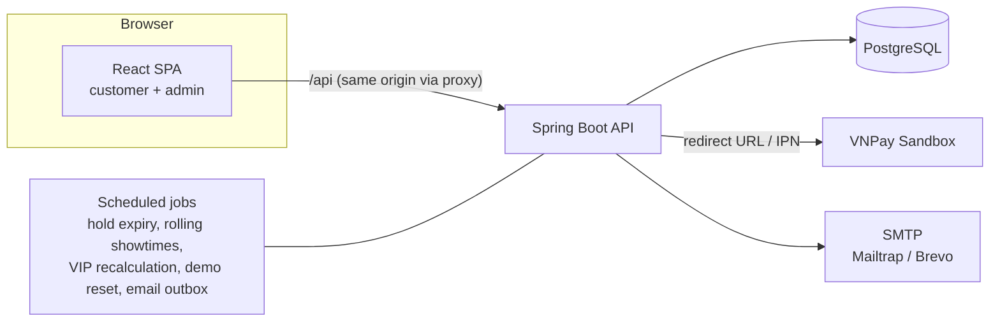
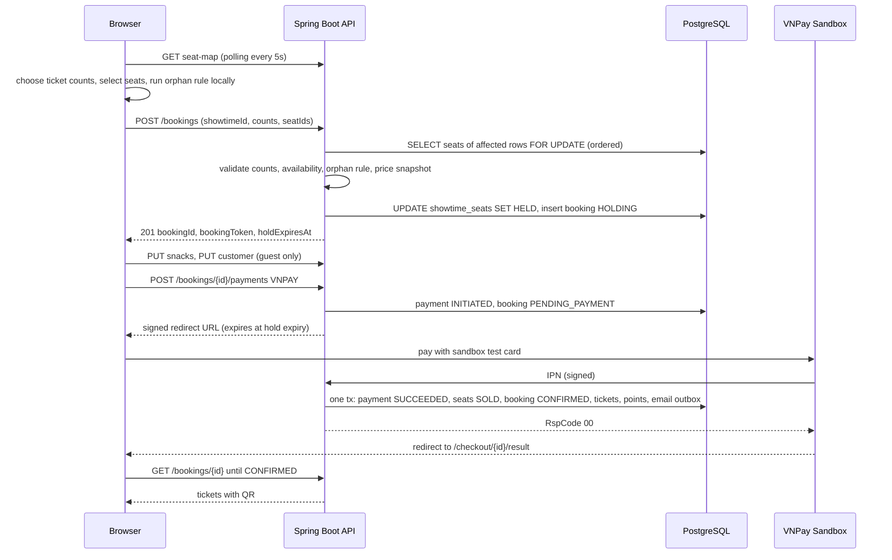
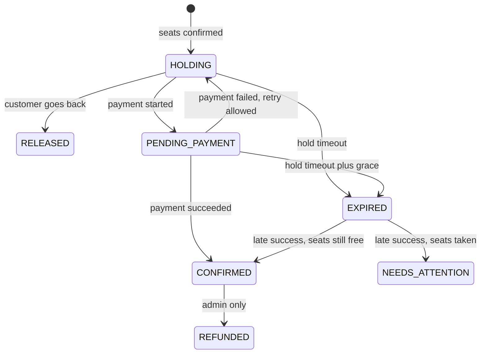

# CineBot – Implementation Plan (v1, without Chatbot & Kiosk)

> **Reference only.** The canonical docs are now `PRD.md`, `RULES.md`, `ARCHITECTURE.md`, `DESIGN.md` and `PROGRESS.md`. Where this plan differs from them (e.g. orphan-rule test case 7), they win.

| Item | Value |
| --- | --- |
| Scope of this plan | Customer website, admin website, booking + payment, membership points, VI/EN |
| Explicitly deferred | Chatbot, kiosk printing, staff check-in (schema is prepared for them) |
| Backend | Java 21, Spring Boot (latest stable), Maven, PostgreSQL 16, Flyway |
| Frontend | Existing prototype stack: Vite + React 18 + TypeScript + Tailwind v4 + shadcn/ui |
| Cinema model | 1 cinema, 5 rooms; schema supports more cinemas |
| Demo strategy | Fixed movie catalogue + rolling showtimes + nightly demo reset |

> This plan supersedes several assumptions in `PRD-CinemaBooking.md` (points rate, tiers, number of rooms, rolling window length, couple-seat tickets). Section 13 lists the differences so the PRD can be updated.

---

## 1. Business Rules (agreed + decisions made for you)

### 1.1 Ticket types and seat types

There are **two seat types** and **three things a customer can buy**:

| Purchase option | Seat type | People | Price |
| --- | --- | --- | --- |
| Adult (regular) | Single | 1 | Depends on day type (see 1.2) |
| Student HSSV-U22 | Single | 1 | Fixed, same every day |
| Couple seat | Couple | 2 | `2 × adult price of that day + 10,000` |

- A couple seat always uses the adult-based formula, regardless of whether the occupants are students.
- Student tickets require a valid student card / ID showing age under 22 at the entrance. A reminder appears when choosing tickets, at checkout and on the ticket.
- **Single-seat type assignment is automatic.** If a customer buys 2 Adult + 1 Student and picks 3 single seats, the system labels the first seat (by seat order) as Student. All single seats cost the same within a type, so per-seat assignment UI adds no value.
- Max **8 seat units per booking** (a couple seat counts as 1 unit).

### 1.2 Price table (seed values, all configurable by admin)

Day type is determined by the **local start date** of the showtime (timezone `Asia/Ho_Chi_Minh`). A show at 00:30 on Sunday morning counts as Sunday.

| Day type | Days | Adult | Student | Couple seat |
| --- | --- | --- | --- | --- |
| Discount day | Tuesday | 45,000 | 45,000 | 100,000 |
| Weekday | Mon, Wed, Thu, Fri | 55,000 | 45,000 | 120,000 |
| Weekend | Sat, Sun | 65,000 | 45,000 | 140,000 |

- **Decision:** student price = 45,000, which equals the cheapest adult price, so a student never pays more than an adult.
- The discount day must be Monday–Friday (validated in admin).
- Public holidays are out of scope for v1. A `price_overrides(date, day_type)` table can be added later.
- Money is stored as `BIGINT` VND, with no decimals anywhere.
- Prices are **snapshotted** into the booking at hold time, so later price changes never alter existing bookings.

### 1.3 Seat map

- Rows are contiguous, with no aisles between seat blocks.
- The **back row(s) contain couple seats only**. All other rows contain single seats.
- Seat statuses per showtime: `AVAILABLE`, `HELD`, `SOLD`, `BLOCKED` (broken / not for sale).
- The frontend additionally shows `SELECTED` (by me) and `HELD_BY_ME` (my active hold).

### 1.4 Orphan-seat rule ("no single empty seat left at the left end, middle, or right end")

Applies to **single-seat rows only**. In a couple row each couple seat is an independent unit, so no rule is needed there.

**Definitions** for one row, with seats ordered left to right:
- `unavailable` = seats that are SOLD, BLOCKED, or HELD by someone else (expired holds count as available).
- `after` = `unavailable ∪ selected`.
- An **orphan** is a maximal run of exactly **one** seat that is not in `after`.

**Rule.** A selection is invalid if it creates an orphan, i.e. there is an orphan seat whose left or right neighbour is in `selected`.

Why "neighbour is selected" detects exactly the *new* orphans: before the selection, that neighbour was empty, so the run was at least two seats long. Pre-existing orphans never block a booking.

**Exception (prevents dead ends when the hall is nearly full).** The selection is allowed if, inside the empty run (computed *before* selecting) that contains the selected seats, the customer selected all seats but one. Example: an empty gap of exactly 3 seats where 2 people want to sit together.

**Test cases** (row of 10, `X` = unavailable, `S` = selected, `_` = empty):

| Row state after selection | Result | Reason |
| --- | --- | --- |
| `S S _ _ _ _ _ _ _ _` | Valid | No orphan |
| `_ S S _ _ _ _ _ _ _` | Invalid | Seat 1 orphaned at the left end |
| `_ _ _ _ _ _ _ _ S _` | Invalid | Seat 10 orphaned at the right end |
| `_ _ S _ S _ _ _ _ _` | Invalid | Seat 4 orphaned in the middle |
| `X X _ S S X _ _ _ _` | Valid | Gap was 3 seats; 2 selected, unavoidable (exception) |
| `X _ X S S _ _ _ _ _` | Valid | Seat 2 was already an orphan; not created by this selection |
| `X S _ X _ _ _ _ _ _` | Invalid | Gap of 2 seats; selecting 1 creates an orphan |

The rule is implemented **twice with the same test table**: in TypeScript for instant feedback, and in Java as the authoritative check inside the hold transaction.

### 1.5 Seat hold and anti-double-booking: when to lock?

**Decision: lock when the customer confirms the seat selection**, meaning they click "Continue" on the seat map. Locking does not happen on each seat click, and it does not wait until payment.

| Option | Problem |
| --- | --- |
| Lock on every seat click | Many requests, lots of abandoned locks, and seats flicker for other users. The orphan rule must be evaluated on the full selection anyway. |
| Lock only at payment | The customer spends minutes on snacks and contact info, then loses the seats at the last step. That is very bad UX, and you would need to handle money for seats that are gone. |
| **Lock on seat confirmation** | Seats are guaranteed during snacks, contact info and payment. This is the standard approach used by cinema chains. |

- Hold duration: **10 minutes** (configurable; the PRD proposed 15). A countdown is visible from the snack step through payment.
- The VNPay payment URL expires at the hold expiry time, so a customer cannot pay after the seats are released.
- One active hold per user/session: creating a new hold releases the previous one.
- The customer can go back from the snack step and change seats. This releases the hold and requires a new one.
- Late payment confirmation: see 5.4.

### 1.6 Purchase policy

- **No cancellation or refund by customers** once paid. Abandoned holds simply expire. That is not a cancellation.
- Admin can manually mark a booking `REFUNDED` for exceptional cases, such as the cinema cancelling a showtime. This reverses the points.

### 1.7 Membership points (decisions made for you)

| Rule | Value |
| --- | --- |
| Who earns | Logged-in members only (guests earn nothing) |
| Earning rate | **5% of the ticket subtotal** in VND, stored as integer points (1 point = 1 VND of value). Snacks earn nothing. |
| When credited | Immediately when payment is confirmed (no cancellations, so no waiting period) |
| Point validity | Each point expires **12 months** after it was earned (rolling window) |
| Tiers | One milestone: **Member → VIP** |
| VIP threshold | **50,000 points within the last 12 months** (= 1,000,000 VND of tickets, roughly 9 visits for two on weekdays) |
| VIP duration | **12 months** from the day the threshold is reached. When it expires, VIP renews only if the rolling 12-month total is still ≥ 50,000. |
| VIP benefit | **15% off all snacks and combos**, applied automatically at checkout |
| Redemption | Points are not spent. They only qualify the member for VIP. |

Example: a Saturday booking with 2 adults (130,000) and one combo earns `130,000 × 5% = 6,500` points.

The account page shows a progress bar ("12,500 / 50,000 points to VIP"). Seed data includes a demo member who is already VIP and one close to the threshold, so recruiters can see both states.

### 1.8 Guest vs. member checkout

| Step | Guest | Member |
| --- | --- | --- |
| 1. Customer info (name, phone, email) | Required | Skipped; profile data shown in the order summary and editable |
| 2. Payment | Yes | Yes |
| 3. Ticket | Yes | Yes |

Guests find their booking later through **booking code + email or phone** (rate-limited).

---

## 2. System Architecture



- A single deployable backend (modular monolith, package-by-feature). There are no microservices at this scale. That is a deliberate, explainable choice.
- No Redis in v1. PostgreSQL row locks handle seat holds correctly (section 5). Redis can be added later for caching or rate limiting across instances.
- `java.time.Clock` is injected everywhere, so time-based logic (holds, rolling window, VIP expiry) is unit-testable.

---

## 3. Backend Design (Spring Boot)

### 3.1 Libraries

| Concern | Choice |
| --- | --- |
| Web / validation | Spring Web, Bean Validation, `ProblemDetail` (RFC 7807) errors with stable `code` fields |
| Persistence | Spring Data JPA (Hibernate) + native SQL for seat locking; Flyway migrations |
| Security | Spring Security, JWT (Nimbus via `spring-boot-starter-oauth2-resource-server`, HS256), BCrypt |
| Mapping | MapStruct (+ Lombok optional) |
| Docs | springdoc-openapi (public Swagger UI, useful for the CV) |
| Scheduling | `@Scheduled` (+ ShedLock if ever run with more than one instance) |
| Rate limiting | Bucket4j (login, booking lookup, hold creation) |
| QR codes | ZXing |
| Email | Spring Mail + Thymeleaf templates, sent through an outbox table |
| Tests | JUnit 5, AssertJ, Testcontainers (PostgreSQL), MockMvc |

### 3.2 Package structure

```
backend/
  pom.xml
  docker-compose.yml                  # local PostgreSQL
  src/main/java/com/cinebot/
    common/      config, error handling, security, i18n, time (Clock), util
    auth/        register, login, refresh rotation, logout
    user/        profile, "my bookings"
    catalog/     movies, translations, genres, credits
    cinema/      cinema, rooms, seats, layout generator
    schedule/    showtimes, templates, rolling generator, overlap checks
    pricing/     pricing policy, price calculator
    booking/     holds, orphan-seat rule, snacks, customer info, lookup
    payment/     PaymentGateway interface, VnpayGateway, MockGateway, IPN handling
    ticket/      ticket issuing, QR tokens (check-in later)
    membership/  point ledger, VIP evaluation
    admin/       admin controllers, dashboard stats, audit log
    demo/        seed loader, nightly reset
  src/main/resources/
    db/migration/V1__init.sql, V2__..., 
    seed/        movies.json, rooms.json, templates.json, snacks.json, pricing.json
    templates/email/booking-confirmed_{vi,en}.html
```

### 3.3 Authentication: JWT with refresh-token rotation

| Token | Lifetime | Storage (browser) | Storage (server) |
| --- | --- | --- | --- |
| Access token (JWT) | 15 min | In memory only (JS variable) | Not stored (stateless) |
| Refresh token (opaque, 256-bit random) | 7 days | `HttpOnly; Secure; SameSite=Strict; Path=/api/auth` cookie | SHA-256 hash in `refresh_tokens` |

**Flows:**
- **Login:** issue an access token + a refresh token with a new `family_id`.
- **Refresh (`POST /api/auth/refresh`):** look up the hash.
  - If the token is valid: mark it `replaced_by` the new one, then issue a new access token + refresh token in the **same family**.
  - If the token was already used or revoked, this is **reuse detection**: revoke the whole family (a stolen token was probably replayed) and return 401.
  - A 10-second grace window returns the same successor when two browser tabs refresh at the same moment. The frontend also uses a single-flight refresh to avoid most of these races.
- **Logout:** revoke the family and clear the cookie.
- **App start:** the frontend calls `/api/auth/refresh` once to restore the session silently.
- **Access token claims:** `sub` (user id), `role` (`CUSTOMER` | `ADMIN`), `exp`, `jti`.
- **CSRF:** the refresh cookie is only sent to `/api/auth/*`. Those endpoints also require the `X-Requested-With: XMLHttpRequest` header and an `Origin` allow-list check.

**Deployment note (important).** If the frontend is on `*.vercel.app` and the API on `*.onrender.com`, the cookie is third-party and Safari/Chrome will block it. Serve the API **through the frontend's domain** (Vercel rewrite `/api/* → backend`), or put both under one custom domain (`app.x.dev` / `api.x.dev`).

**Guest booking authorization.** Guests have no JWT. `POST /api/bookings` returns a random `bookingToken`, and the server stores only its hash. The client keeps the token in `sessionStorage` and sends `X-Booking-Token` on every call for that booking (snacks, customer info, payment, viewing tickets). Members are authorized by `user_id`; they receive the token as well, so the API stays uniform.

### 3.4 Database schema

Conventions: `id BIGSERIAL` (bookings use `UUID`), `created_at/updated_at timestamptz`, enums stored as `text` + `CHECK`.

**Identity**
```
users(id, email UNIQUE, password_hash, full_name, phone, role, preferred_locale,
      vip_since, vip_until, created_at)
refresh_tokens(id, user_id FK, token_hash UNIQUE, family_id uuid, expires_at,
               revoked_at, replaced_by_id, created_ip, user_agent, created_at)
```

**Cinema and seats** (the physical layout, which never changes per showtime)
```
cinemas(id, name, address, phone, timezone)                 -- 1 row
rooms(id, cinema_id FK, name, cleanup_minutes DEFAULT 15, is_active, is_seed)
seats(id, room_id FK, row_label, seat_number, col_index, seat_type SINGLE|COUPLE,
      is_active, UNIQUE(room_id, row_label, seat_number))
```

**Catalogue**
```
movies(id, slug UNIQUE, original_title, duration_min, age_rating P|K|T13|T16|T18,
       country_code, audio_language, subtitle_language, release_date,
       release_offset_days NULL, status NOW_SHOWING|COMING_SOON|ENDED,
       poster_url, backdrop_url, trailer_youtube_id, is_seed, created_at, updated_at)
movie_translations(movie_id FK, locale vi|en, title, synopsis, PK(movie_id, locale))
genres(id, code UNIQUE) ; genre_translations(genre_id, locale, name)
movie_genres(movie_id, genre_id)
movie_credits(id, movie_id FK, role DIRECTOR|CAST, person_name, sort_order)
```

**Scheduling**: one cinema has many movies, each movie has many dates, each date has many start times, and each start time has its own seats.
```
showtime_templates(id, movie_id FK, room_id FK, start_time time,
                   days_of_week smallint  -- bitmask Mon..Sun
                   active, is_seed)
showtimes(id, movie_id FK, room_id FK, starts_at timestamptz, ends_at timestamptz,
          blocked_until timestamptz,      -- ends_at + room.cleanup_minutes
          status SCHEDULED|CANCELLED, source TEMPLATE|MANUAL, template_id NULL,
          UNIQUE(room_id, starts_at))
showtime_seats(showtime_id FK, seat_id FK, status AVAILABLE|HELD|SOLD|BLOCKED,
               booking_id uuid NULL, hold_expires_at timestamptz NULL,
               PRIMARY KEY (showtime_id, seat_id))
```
- The "date" of a showtime is derived from `starts_at` in the cinema timezone. There is no separate date table.
- `showtime_seats` is generated when a showtime is created (one row per seat in the room), so **seat A5 at 18:00 and seat A5 at 21:00 are independent rows**. Size estimate: 5 rooms × 5 shows × 7 days × ~130 seats ≈ 23k rows, which is trivial.
- No room overlap, enforced by the database itself:
  ```sql
  CREATE EXTENSION IF NOT EXISTS btree_gist;
  ALTER TABLE showtimes ADD CONSTRAINT no_room_overlap
    EXCLUDE USING gist (room_id WITH =, tstzrange(starts_at, blocked_until) WITH &&)
    WHERE (status <> 'CANCELLED');
  ```

**Pricing and snacks**
```
pricing_policies(id, effective_from timestamptz, discount_day_of_week smallint,
                 adult_discount_day, adult_weekday, adult_weekend,
                 student_price, couple_surcharge, vip_snack_discount_pct,
                 points_rate_pct, vip_threshold_points)
snacks(id, code UNIQUE, price, image_url, is_combo, active, sort_order, is_seed)
snack_translations(snack_id, locale, name, description)
```

**Booking, payment, tickets**
```
bookings(id uuid, code UNIQUE,            -- 8 chars, Crockford base32, SecureRandom
         showtime_id FK, user_id NULL, access_token_hash,
         status HOLDING|PENDING_PAYMENT|CONFIRMED|EXPIRED|RELEASED|NEEDS_ATTENTION|REFUNDED,
         hold_expires_at, customer_name, customer_phone, customer_email, locale,
         ticket_subtotal, snack_subtotal, snack_discount, total,
         points_earned, created_at, confirmed_at)
booking_seats(booking_id FK, seat_id FK, ticket_type ADULT|STUDENT|COUPLE,
              unit_price, PK(booking_id, seat_id))
booking_snacks(booking_id FK, snack_id FK, quantity, unit_price, discount_pct)
payments(id, booking_id FK, provider VNPAY|MOCK, txn_ref UNIQUE, amount,
         status INITIATED|SUCCEEDED|FAILED|EXPIRED, provider_txn_no,
         raw_response jsonb, created_at, completed_at)
tickets(id, booking_id FK, seat_id FK, ticket_type, admits smallint,  -- 2 for couple
        qr_token UNIQUE, status VALID|CHECKED_IN|VOID, checked_in_at NULL)
```
`showtime_seats` is the **single source of truth** for seat ownership. Its primary key plus conditional updates make double-selling impossible.

**Membership, ops**
```
point_ledger(id, user_id FK, booking_id NULL, points, type EARN|REVERSAL|ADJUST,
             earned_at, expires_at)
email_outbox(id, type, payload jsonb, status PENDING|SENT|FAILED, attempts,
             next_attempt_at, last_error)
audit_log(id, actor_user_id, action, entity_type, entity_id, changes jsonb, created_at)
```

**Key indexes:** `showtimes(movie_id, starts_at)`, `showtimes(room_id, starts_at)`, `showtime_seats(booking_id)`, `showtime_seats(status, hold_expires_at)` (partial, where `status='HELD'`), `bookings(code)`, `bookings(user_id, created_at)`, `point_ledger(user_id, earned_at)`.

### 3.5 Five rooms (seed layouts)

| Room | Single rows | Seats per row | Couple row | Couple seats | Capacity (people) |
| --- | --- | --- | --- | --- | --- |
| Room 1 | A–J (10) | 16 | K | 8 | 176 |
| Room 2 | A–I (9) | 14 | J | 7 | 140 |
| Room 3 | A–H (8) | 12 | I | 6 | 108 |
| Room 4 | A–H (8) | 12 | I | 6 | 108 |
| Room 5 | A–F (6) | 10 | G | 5 | 70 |

Admin creates and edits layouts with a **generator form** (number of single rows, seats per row, number of couple rows, couple seats per row), plus toggling individual seats to `BLOCKED`. A drag-and-drop editor is unnecessary for v1. A layout cannot be regenerated while the room has future showtimes with holds or sales.

### 3.6 REST API

**Public catalogue**
```
GET  /api/movies?status=NOW_SHOWING|COMING_SOON&genre=
GET  /api/movies/{slug}
GET  /api/movies/{slug}/showtimes?from=2026-11-11&days=7   -> grouped by date, then room
GET  /api/showtimes/{id}                                   -> movie, room, startsAt, prices for that day
GET  /api/showtimes/{id}/seat-map                          -> rows[] of seats with status
GET  /api/snacks
GET  /api/cinema                                           -> cinema info + rooms
```

**Booking (guest or member)**
```
POST   /api/bookings                      {showtimeId, adult, student, couple, seatIds[]}
                                          -> 201 {bookingId, bookingToken, holdExpiresAt, priceBreakdown}
                                          -> 409 SEAT_UNAVAILABLE | 422 ORPHAN_SEAT | 422 TICKET_COUNT_MISMATCH
GET    /api/bookings/{id}                 -> status, remaining hold time, breakdown
PUT    /api/bookings/{id}/snacks          {items:[{snackId, quantity}]}
PUT    /api/bookings/{id}/customer        {fullName, phone, email}
DELETE /api/bookings/{id}                 -> release hold (go back to seat map)
POST   /api/bookings/{id}/payments        {provider: VNPAY|MOCK} -> {paymentId, redirectUrl}
GET    /api/bookings/{id}/tickets         -> only when CONFIRMED
POST   /api/bookings/lookup               {code, emailOrPhone}  (rate-limited)
```

**Payment callbacks**
```
GET  /api/payments/vnpay/ipn              server-to-server, signed, idempotent
GET  /api/payments/vnpay/return           browser return; verifies signature, never confirms by itself
POST /api/payments/mock/{paymentId}       {result: SUCCESS|FAILED}  (demo gateway page)
```

**Auth and account**
```
POST /api/auth/register | /login | /refresh | /logout
GET  /api/me            PUT /api/me
GET  /api/me/bookings   GET /api/me/membership   -> points, rolling total, VIP status, ledger
```

**Admin** (`ROLE_ADMIN`)
```
/api/admin/dashboard                 today's showtimes, bookings, revenue (7 days), occupancy
/api/admin/movies                    CRUD (VI/EN content), change status
/api/admin/rooms                     list, layout generator, block/unblock seats
/api/admin/showtimes                 list by date/room, create (overlap check), cancel
/api/admin/showtime-templates        CRUD, POST /regenerate (fill rolling window now)
/api/admin/pricing                   current policy, create new policy version
/api/admin/snacks                    CRUD
/api/admin/bookings                  search by code/phone/email/date, detail, mark refunded
/api/admin/audit-log
```

Errors use `ProblemDetail` with a machine-readable `code`. **The frontend translates codes into VI/EN**, so the backend never builds user-facing sentences.

---

## 4. Booking Flow (end to end)



### 4.1 Booking state machine



---

## 5. Concurrency: How Double Booking Is Prevented

### 5.1 Creating a hold (one transaction)

```sql
-- 1. Lock every seat in the rows touched by the request, in a fixed order (no deadlocks).
SELECT ss.seat_id, ss.status, ss.booking_id, ss.hold_expires_at
FROM showtime_seats ss
JOIN seats s ON s.id = ss.seat_id
WHERE ss.showtime_id = :showtimeId
  AND s.row_label IN (:rowLabels)
ORDER BY ss.seat_id
FOR UPDATE OF ss;

-- 2. In Java: treat HELD with hold_expires_at < now() as AVAILABLE,
--    check every requested seat is available, check ticket counts,
--    run the orphan rule on each affected row with this locked, current state.

-- 3. Take the seats.
UPDATE showtime_seats
SET status = 'HELD', booking_id = :bookingId, hold_expires_at = :expiresAt
WHERE showtime_id = :showtimeId AND seat_id IN (:seatIds);
```

Locking the **whole row** (not just the chosen seats) matters. Two people choosing A3 and A5 at the same time could each pass the orphan check alone but together orphan A4. Row-level serialization prevents this. Rows hold at most about 16 seats, so contention is negligible.

### 5.2 Confirming after payment

```sql
UPDATE showtime_seats SET status = 'SOLD', hold_expires_at = NULL
WHERE showtime_id = :showtimeId AND booking_id = :bookingId AND status = 'HELD';
-- updated row count must equal the booking's seat count, otherwise -> late-payment path (5.4)
```

### 5.3 Expiry

- **Lazy:** every read and hold treats expired holds as available. Correctness never depends on the job running on time.
- **Job (every 30s):** sets expired seats back to `AVAILABLE` and moves bookings to `EXPIRED`. `PENDING_PAYMENT` bookings get a 2-minute grace period after `hold_expires_at`, because an IPN for a payment completed just before the deadline can arrive slightly late.

### 5.4 Late payment success

If an IPN arrives for an `EXPIRED` booking:
- If its seats are still free (or still held by it), re-take them and confirm normally.
- If another booking has taken the seats, set `NEEDS_ATTENTION`. It appears in the admin bookings page for a manual refund. No ticket is issued.

### 5.5 Real-time seat updates

- v1: the seat map polls `GET /seat-map` every 5 seconds while open, and always refreshes after a 409 error.
- Later: Server-Sent Events (`SseEmitter`) per showtime, which the chatbot can reuse.

---

## 6. Payment

### 6.1 Gateways

A `PaymentGateway` interface has two implementations, and both are offered in the demo:

| Gateway | Purpose |
| --- | --- |
| **VNPay Sandbox** | Realistic Vietnamese payment flow: signed redirect URL, HMAC-SHA512 checksum, IPN, test cards with OTP. Shows recruiters a real integration. |
| **Demo Pay (mock)** | An internal page with "Pay successfully" / "Simulate failure" buttons. Always works, even if the VNPay sandbox is down or slow. Also used for local development and automated tests. |

The checkout shows a visible **"Demo – test payment, no real money"** banner and lists the VNPay sandbox test card details.

### 6.2 VNPay rules to implement

- `vnp_TxnRef` = `payments.txn_ref` (unique per attempt, so a failed attempt can be retried with a new reference).
- `vnp_Amount` = total × 100. `vnp_ExpireDate` = booking hold expiry.
- **IPN handler is the only thing that confirms a booking.** It must:
  - verify the checksum;
  - check that `txn_ref` exists and the amount matches;
  - be idempotent: if the payment is already `SUCCEEDED`, answer "already confirmed" and do nothing else;
  - run the confirmation in one transaction;
  - answer with VNPay's expected `RspCode`.
- **Return URL handler** only verifies the signature and redirects the user to the result page. The result page polls `GET /bookings/{id}` until the status is final.
- Local development: the IPN needs a public URL. Use a tunnel (e.g. ngrok / Cloudflare Tunnel), or a reconciliation job that calls VNPay's transaction query API for `INITIATED` payments older than 1 minute. Implement the reconciliation job anyway; it makes the system robust.

### 6.3 What happens in the confirmation transaction

1. `payments.status = SUCCEEDED`, store the raw response.
2. Seats `HELD → SOLD` (see 5.2).
3. `bookings.status = CONFIRMED`, `confirmed_at = now()`.
4. Create tickets (one per seat; a couple seat has `admits = 2`), each with a random QR token.
5. If it is a member booking: insert an `EARN` row in `point_ledger` and re-evaluate VIP.
6. Insert an `email_outbox` row. A separate job sends the email, so an SMTP failure never rolls back a paid booking.

---

## 7. Rolling Showtimes and Demo Stability

### 7.1 Rolling generator

- Admin manages **showtime templates**: movie, room, start time, and days of the week.
- A job runs daily at 00:05 (cinema time) **and on application startup**. It ensures showtimes exist for **today through today + 6** (7 days, matching the date strip in the UI).
  - Idempotent: `UNIQUE(room_id, starts_at)` plus "insert if missing".
  - Skips any slot that would violate the room overlap constraint and logs a warning.
  - Creates the `showtime_seats` rows.
- **Free-tier hosting sleeps**, so scheduled jobs may not run at midnight. A lazy guard also runs the generator on the first catalogue request of a new day.
- **Simulated occupancy:** newly generated showtimes get 15–35% of seats marked `SOLD` to a system "walk-in" booking. The choice is deterministic per showtime, so seat maps look realistic and the orphan rule is easy to try. This replaces the random occupancy of the prototype.
- Past showtimes are kept so booking history stays valid. They are simply not shown publicly.

### 7.2 Fixed catalogue

- Seed movies (about 6 now showing + 6 coming soon) are defined in `seed/movies.json` with stable slugs and `is_seed = true`.
- Coming-soon release dates would become stale, so seed movies store `release_offset_days`. The nightly job recomputes `release_date = today + offset`, so "Coming soon – 28/11" always lies in the future.
- `NOW_SHOWING` / `COMING_SOON` is a manual status, not derived from dates.
- Coming-soon movies never get showtimes and show "No showtimes yet". The booking button is hidden.

### 7.3 Admin that really works, without destroying the demo

- Demo admin credentials are shown on the admin login page.
- Admin can create, edit and delete anything. **Seed rows (`is_seed = true`) cannot be deleted**; the UI shows a lock icon with the explanation "seed data". They can still be edited.
- **Nightly reset (03:00):**
  1. Restore seed movies, rooms, templates, snacks and pricing from the seed JSON (upsert by slug/code).
  2. Delete non-seed content created by admins.
  3. Delete bookings and payments older than 7 days, plus all non-seed data for showtimes in the past.
  4. Regenerate the rolling window.
- Seed demo accounts: `vip@demo.cinebot` (VIP), `member@demo.cinebot` (close to VIP), `admin@demo.cinebot`. They are re-created by the reset.

---

## 8. Frontend Plan (based on the existing prototype)

### 8.1 What to keep from the prototype

- The visual identity: dark theme, `Barlow Condensed` headings, `DM Mono` labels, `DM Sans` body, primary/accent tokens in `theme.css`, sharp-cornered cards, poster grid, fixed bottom summary bar on the seat page, the ticket-style confirmation card.
- shadcn/ui components in `components/ui/` (replace the hand-made `Input`/`Select`/`Field` in `App.tsx` with them).
- Screen inventory: Browse, Coming Soon, Showtimes, Seats, Confirm, Sign-in modal, Admin panel (sidebar layout).

### 8.2 What changes

| Prototype | Change |
| --- | --- |
| Everything in `App.tsx` (1,500 lines) | Split into pages/features (8.4) |
| `view` state instead of URLs | React Router routes (8.3) |
| Hard-coded seed arrays | API via TanStack Query |
| London cinemas, £, UK ratings (PG-13, R) | One Vietnamese cinema, VND, age ratings P/K/T13/T16/T18 |
| Coming Soon as a separate list page | Tab on the home page using the same poster grid (with a release-date badge) |
| Cinemas page (4 cinemas) | "Our cinema" page: one cinema, its 5 rooms, address, map |
| Memberships page (paid subscriptions) | Membership program page: 5% points, VIP milestone, 15% off snacks |
| Format selector (IMAX/Dolby) on showtimes | Removed; showtimes grouped by room |
| Admin: Theatres, Location tabs | Admin: Rooms & layouts, Templates, Pricing, Snacks, Bookings |
| Hard-coded admin credentials | Real login with `ROLE_ADMIN` |
| Header location button | Language switcher **VI / EN** |
| Booking fee £1.50 | Removed (not in the business rules) |

### 8.3 Routes

```
/                              Home: hero + tabs [Now showing | Coming soon] (?tab=coming-soon)
/movies/:slug                  Movie detail + showtimes
/booking/:showtimeId           Steps: Tickets -> Seats -> Snacks  (hold created when leaving Seats)
/checkout/:bookingId           Steps: 1 Info (guest only) -> 2 Payment -> 3 Ticket
/checkout/:bookingId/result    Return page from VNPay / Demo Pay (polls status)
/pay/mock/:paymentId           Demo Pay page
/bookings/lookup               Guest booking lookup
/account                       Profile, my bookings, points and VIP progress
/membership                    Program explanation
/cinema                        Cinema info and rooms
/admin/login, /admin/*         Admin area (separate layout, lazy-loaded bundle)
```

### 8.4 Folder structure

```
src/
  app/            router.tsx, providers.tsx (QueryClient, i18n, auth)
  pages/          HomePage, MovieDetailPage, BookingPage, CheckoutPage, ...
  pages/admin/    DashboardPage, MoviesPage, RoomsPage, ShowtimesPage, ...
  features/
    movies/       MovieCard, MovieHoverInfo, MovieGrid, TrailerSection
    showtimes/    DateStrip, ShowtimeList
    booking/      TicketCounter, SeatMap, Seat, orphanRule.ts (+ tests), SnackPicker,
                  HoldCountdown, BookingSummaryBar
    checkout/     CustomerInfoStep, PaymentStep, TicketStep, OrderSummary
    auth/         AuthModal, useAuth, authStore
    membership/   VipProgress, PointLedgerTable
  components/ui/  shadcn (existing)
  components/layout/ Nav, Footer, LanguageSwitcher, AdminLayout
  lib/            api.ts (axios + refresh interceptor), money.ts, dates.ts
  i18n/           index.ts, locales/vi.json, locales/en.json
  styles/         (existing)
```

New dependencies: `@tanstack/react-query`, `zustand`, `axios`, `i18next`, `react-i18next`, `zod` (with the existing `react-hook-form`), `vitest`. Remove unused prototype dependencies (`@mui/*`, `@emotion/*`, `react-slick`, `react-dnd`, …) and the Figma asset plugin.

### 8.5 Key screens

**Home**
- Hero: featured now-showing movie with "Book tickets" and "Watch trailer" buttons (trailer opens a dialog).
- Tabs **Now showing / Coming soon** plus genre chips (both already exist in the prototype).
- **Poster hover (desktop):** the overlay slides up showing genres, duration, country, audio/subtitle language and the age badge, plus a "Book now" button (now showing) or the release date (coming soon).
- **Mobile:** no hover; tapping a poster opens the detail page. Basic info is shown under the poster.

**Movie detail**
1. Header: backdrop, poster, title, age badge, then the same info as the hover card plus **director, cast and release date**.
2. **Synopsis.**
3. **Trailer:** YouTube thumbnail with a play button. The iframe loads only when clicked.
4. **Showtimes** (now showing only): a 7-day date strip (reuses the prototype's date buttons) with time chips grouped by room. Each chip shows "xx seats left". Coming soon shows "No showtimes yet".

**Booking page** (adapts the prototype's `SeatsView`)
- **Tickets step:** counters for Adult / Student / Couple with the price for *that* showtime's day type, and a student ID reminder.
- **Seats step:** screen indicator; single rows on top, the couple row at the back drawn as double-width seats. Legend: available / selected / held / sold / blocked (labelled, not colour-only). The orphan rule runs live and shows a message such as "Please don't leave seat A4 empty on its own". "Continue" stays disabled until the selected seats match the ticket counts and the rule passes.
- **Snacks step:** snack/combo cards with quantity steppers. VIP members see the 15% discount on each item. The countdown timer is visible.
- Bottom summary bar (from the prototype): seats, ticket breakdown, total, and the **"Book"** button, which redirects to checkout.

**Checkout** (`/checkout/:bookingId`)
- Stepper `1 Info → 2 Payment → 3 Ticket`. Members see `Payment → Ticket`, with their contact details in an editable summary card.
- Right column: order summary (movie, room, date/time, seats with ticket types, snacks, VIP discount, total) and the hold countdown. When the hold expires, a dialog sends the customer back to the seat map.
- Ticket step: reuses the prototype's ticket card with the booking code, **QR code**, seats and snacks, plus a "Print / Save as PDF" button (print CSS) and an "email sent to …" notice.

**Admin** (keeps the prototype's sidebar layout)
- **Dashboard:** KPI cards, today's showtimes, revenue over the last 7 days (recharts is already a dependency).
- **Movies:** table + form with VI/EN tabs for title and synopsis; seed lock icon.
- **Rooms:** layout preview (read-only seat map component), generator form, block/unblock seats.
- **Showtimes:** day view with **5 room lanes on a timeline**; create a manual showtime (the API returns an overlap error), cancel a showtime.
- **Templates:** weekly pattern editor and a "Regenerate next 7 days" button.
- **Pricing:** discount day, three adult prices, student price, couple surcharge, VIP %, with a live preview of the resulting price table.
- **Snacks:** CRUD.
- **Bookings:** search, detail (seats, payments, tickets), "Mark refunded" for `NEEDS_ATTENTION` bookings.

### 8.6 Internationalisation (VI/EN)

- UI strings live in `react-i18next` JSON files. The language is stored in `localStorage` and defaults to `vi`.
- Every API call sends `Accept-Language`. The backend returns movie/genre/snack text in that locale and falls back to `vi`.
- Money is formatted with `Intl.NumberFormat('vi-VN', {style:'currency', currency:'VND'})` in both languages. Dates use the `date-fns` locale.
- Switching language must not lose the booking state. Booking state lives in a Zustand store + `sessionStorage`, not in components.
- Confirmation emails are sent in the booking's locale.

---

## 9. Security Checklist

- BCrypt passwords; rate-limited login (5/min/IP) and booking lookup (5/min/IP).
- Prices, totals, discounts and points are **always computed on the server**. The client only sends seat ids, counts and snack quantities.
- Booking codes and QR tokens come from `SecureRandom` and contain no personal data.
- The VNPay secret, JWT secret and SMTP credentials come from environment variables, never the repository.
- CORS allow-list; HTTPS only in deployment; admin endpoints protected by role; audit log for admin writes.
- Request validation with Bean Validation (phone format, email, quantity limits).

---

## 10. Testing Strategy

| Level | What |
| --- | --- |
| Unit (Java) | `OrphanSeatRule` (the table in 1.4 plus edge cases), `PriceCalculator` (each day type, couple formula, VIP snack discount), `MembershipService` (earning, 12-month expiry, VIP grant/renewal using a fixed `Clock`), VNPay checksum signing/verification |
| Unit (TS) | `orphanRule.ts` with **the same test table** as Java; price display helpers |
| Integration (Testcontainers) | Concurrent holds: 20 threads request the same seat and exactly one succeeds. Neighbouring-seat race (A3 + A5) where one must fail. IPN delivered twice issues tickets and points once. Late IPN after expiry follows both branches. Overlap exclusion constraint. Rolling generator is idempotent. Refresh-token reuse revokes the family. |
| API | MockMvc tests for auth rules (guest token required, member ownership, admin role) |
| E2E (optional) | Playwright: guest books with Demo Pay; member checkout skips step 1 |

CI: GitHub Actions runs backend tests (Testcontainers) and frontend lint, typecheck, Vitest and build on every push.

---

## 11. Deployment

| Part | Suggestion |
| --- | --- |
| Frontend | Vercel or Netlify, with a rewrite of `/api/*` to the backend (keeps the refresh cookie first-party) |
| Backend | Docker image on Railway / Fly.io / Render. Prefer a plan that does not sleep: a 50-second cold start makes recruiters think the site is broken. |
| Database | Neon or Supabase PostgreSQL (`btree_gist` is available on both) |
| Email | Brevo / Resend free tier, or Mailtrap for sandbox-only email |
| Monitoring | Spring Boot Actuator health endpoint plus an uptime pinger |

---

## 12. Milestones

Durations assume part-time work. Each phase is done only when its "Done when" items pass.

**Phase 0 – Foundations (≈1 week)**
- Backend: Spring Boot skeleton, Docker Compose PostgreSQL, Flyway `V1`, error format, OpenAPI, CI.
- Frontend: split `App.tsx`, router, QueryClient, axios client, i18n setup with VI/EN switcher, Nav/Footer, remove unused dependencies.
- *Done when:* `docker compose up` + `mvn spring-boot:run` + `pnpm dev` work; CI is green.

**Phase 1 – Catalogue and schedule (≈1.5 weeks)**
- Cinema, 5 rooms, seats from seed; movies with translations, genres, credits; templates; rolling generator with simulated occupancy; public catalogue and showtime APIs.
- Frontend: Home with tabs and hover info, movie detail with synopsis, trailer and showtimes, cinema page.
- *Done when:* after the server date changes, showtimes still cover the next 7 days; a coming-soon movie cannot be booked; switching VI/EN changes movie text.

**Phase 2 – Authentication (≈1 week)**
- Register, login, refresh rotation with reuse detection, logout, `/me`; frontend auth modal (from the prototype), silent refresh, protected `/account`.
- *Done when:* the access token expires and refreshes transparently; replaying an old refresh token logs the user out everywhere.

**Phase 3 – Seat selection and holds (≈2 weeks)**
- Pricing policy and calculator, seat-map API, orphan rule (Java + TS), hold creation with row locks, release, expiry job, snacks.
- Frontend: Tickets → Seats → Snacks steps, countdown, conflict handling (409 refreshes the map).
- *Done when:* the concurrency integration tests pass; the orphan table passes in both languages; prices match the 1.2 table for Tue, Wed and Sat showtimes.

**Phase 4 – Checkout and payment (≈2 weeks)**
- Customer info, Demo Pay, VNPay sandbox (redirect, return, IPN, reconciliation job), confirmation transaction, tickets with QR, email outbox, guest lookup.
- Frontend: checkout stepper (guest 3 steps, member 2 steps), result page, ticket page with print CSS, lookup page.
- *Done when:* a guest and a member both get tickets through VNPay sandbox and Demo Pay; a duplicate IPN changes nothing; an expired hold cannot be paid.

**Phase 5 – Membership (≈0.5 week)**
- Point ledger, VIP evaluation (on payment + nightly), VIP snack discount at checkout, account page with progress and history.
- *Done when:* the demo member crosses 50,000 points with one booking and immediately sees VIP and the snack discount.

**Phase 6 – Admin (≈2 weeks)**
- Admin pages from 8.5, seed protection, audit log, dashboard stats.
- *Done when:* admin can add a movie, add a template and regenerate, create a manual showtime (overlap rejected), change prices (only new bookings affected), and handle a `NEEDS_ATTENTION` booking.

**Phase 7 – Demo hardening and launch (≈1 week)**
- Nightly reset, demo accounts, "test payment" banners, deployment, README (architecture diagram, state machine, concurrency explanation, screenshots, demo credentials).
- *Done when:* the site has worked unattended for 3 consecutive days with bookable showtimes every day.

**Later:** chatbot (reuses the booking API + SSE), kiosk printing, staff check-in (uses `tickets.qr_token` / `status`).

---

## 13. Differences From `PRD-CinemaBooking.md` (update the PRD)

| Topic | PRD | This plan |
| --- | --- | --- |
| Points | 1 point / 10,000 VND, tickets **and** snacks; no tiers | 5% of **ticket** subtotal; snacks excluded; one VIP tier |
| Rooms in demo | 2 | 5 |
| Rolling window | 14 days | 7 days (matches the UI date strip; configurable) |
| Hold duration | 15 minutes | 10 minutes (configurable) |
| Couple seat tickets | 2 separate tickets | 1 ticket with `admits = 2` until check-in exists |
| Single-seat ticket types | Customer assigns per seat | Assigned automatically |
| Aisles / segments | Aisles split segments | No aisles in v1; whole row is one segment |
| Cancellation | Policy to be decided | No customer cancellation; admin-only manual refund |

---

## 14. Decisions to Confirm

1. Student price **45,000** (equal to the Tuesday adult price).
2. Hold duration **10 minutes**.
3. Orphan-rule **exception** for an "exactly one seat left in the gap" situation (1.4). Without it, nearly full showtimes can become unbookable for groups.
4. VIP: **50,000 points / 12 months**, benefit **15% off snacks**.
5. Couple seat = **one ticket admitting two** (until the check-in feature exists).
6. Payment: **VNPay sandbox + Demo Pay** both available in the demo.
