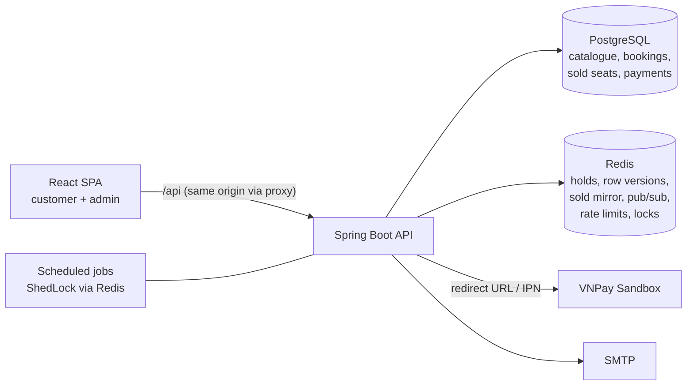

# CineBot – Implementation Plan (v1, without Chatbot & Kiosk)

> **Build plan.** Business rules are defined in `RULES.md`, the technical design in `ARCHITECTURE.md`, UI in `DESIGN.md`, status in `PROGRESS.md`. How the work is split across parallel AI agents is in `AGENT-EXECUTION-PLAN.md`. If this plan disagrees with those files, they win.

| Item | Value |
| --- | --- |
| Scope of this plan | Customer website, admin website, booking + payment, membership points, VI/EN |
| Explicitly deferred | Chatbot, kiosk printing, staff check-in (schema and interfaces are prepared for them) |
| Backend | Java 21, Spring Boot (latest stable), Maven, PostgreSQL 16, **Redis 7**, Flyway |
| Frontend | Existing prototype stack: Vite + React 18 + TypeScript + Tailwind v4 + shadcn/ui |
| Cinema model | 1 cinema, 5 rooms; schema supports more cinemas |
| Seat holds | **Redis** (holds with TTL) + **PostgreSQL** (sold seats, the final authority) |
| Demo strategy | Fixed movie catalogue + rolling showtimes + nightly demo reset |

---

## 1. Business Rules (all confirmed 2026-11-11)

Full definitions are in `RULES.md`. Summary:

| Topic | Rule | Ref |
| --- | --- | --- |
| Purchase options | Adult (single seat), Student HSSV-U22 (single seat), Couple seat (2 people) | BR-01 |
| Adult price | Tuesday 45,000 · Mon/Wed/Thu/Fri 55,000 · Sat/Sun 65,000 (by local start date) | BR-02 |
| Student price | **45,000** fixed | BR-02 |
| Couple seat | `2 × adult price of the day + 10,000` → 100k / 120k / 140k | BR-03 |
| Booking size | 1–8 seat units; single-seat ticket types assigned automatically | BR-05, BR-06 |
| Seat map | Contiguous rows, no aisles; couple seats in the back row | BR-07 |
| Orphan-seat rule | No new single empty seat at the left end, middle or right end; **exception confirmed**: allowed when the selection fills a gap except one seat and is contiguous | BR-08 |
| Hold | Created **on seat confirmation**; **10 minutes**; one active hold per user/browser | BR-09…BR-11 |
| Payment | **VNPay sandbox + Demo Pay**; confirmed only by server notification, idempotently | BR-13, BR-14 |
| Cancellation | No customer cancellation; admin-only manual refund | BR-15 |
| Points | 5% of the ticket subtotal (snacks excluded), members only, each point valid 12 months | BR-16, BR-17 |
| VIP | **50,000 qualifying points** → VIP for 12 months → **15% off snacks** | BR-18, BR-19 |
| Tickets | **One ticket per seat; couple seat ticket admits 2** | ARCHITECTURE §5 |
| Schedule | No room overlap (duration + 15 min cleanup); rolling 7-day window; nightly reset | BR-22…BR-26 |

---

## 2. Seat Holds: Decision and Design

### 2.1 When to lock: on seat confirmation

| Option | Problem |
| --- | --- |
| Lock on every seat click | Many requests, abandoned locks, seats flicker for others; the orphan rule must judge the whole selection anyway |
| Lock only at payment | Customer loses seats after spending minutes on snacks and info; money may arrive for seats that are gone |
| **Lock on seat confirmation** ✅ | Seats guaranteed during snacks, info and payment; standard practice in cinema chains |

### 2.2 Why Redis, and what each store owns

| Store | Owns | Why |
| --- | --- | --- |
| **Redis** | **Holds** (temporary, 10 min TTL), row versions, sold-seat mirror, seat-change pub/sub | Native TTL (no cleanup needed for correctness), atomic Lua scripts, very fast seat-map reads, pub/sub for future real-time updates, multi-instance safe |
| **PostgreSQL** | **Sold seats** (`sold_seats`, primary key `(showtime_id, seat_id)`), bookings, payments, tickets | Durable; the primary key is the **final guarantee** against double selling, even if Redis loses data |

The rule of thumb: **a seat can only be held in Redis and can only be sold in PostgreSQL.** Losing Redis loses unpaid holds (bad UX) but never causes a double sale.

### 2.3 Redis keys (per showtime, cluster-safe hash tag `{st:<id>}`)

| Key | Type | TTL | Meaning |
| --- | --- | --- | --- |
| `cb:{st:42}:seat:<seatId>` | string = bookingId | hold TTL | Seat is held by this booking |
| `cb:{st:42}:booking:<bookingId>` | set of seatIds | hold TTL | All seats of one hold (extend/release in one call) |
| `cb:{st:42}:rowver:<row>` | integer | until showtime end + 1 day | Row version for optimistic concurrency |
| `cb:{st:42}:sold` | set of seatIds | until showtime end + 1 day | Mirror of PostgreSQL `sold_seats` |
| `cb:{st:42}:sold:ready` | string | same | Marker: mirror has been loaded from PostgreSQL |
| `cb:holdowner:<ownerKey>` | string `<showtimeId>:<bookingId>` | hold TTL | One active hold per user / browser (BR-10) |
| channel `cb:seat-events:<showtimeId>` | pub/sub | — | `HELD` / `RELEASED` / `SOLD` events (SSE later) |

`ownerKey` = `u:<userId>` for members, `c:<clientId>` for guests (random UUID the frontend keeps in `localStorage` and sends as `X-Client-Id`).

### 2.4 Creating a hold: optimistic concurrency, rule in Java only

The orphan rule (BR-08) depends on neighbouring seats, so availability must be checked against a consistent view of the whole row. Instead of a distributed lock, use **row versions**: every hold or release in a row increments that row's version.

```
createHold(showtimeId, counts, seatIds, owner):
  1. Validate in Java: showtime is SCHEDULED and not started (BR-24); seats belong to the room
     and are active; counts match seat types (BR-05, BR-07).
  2. Release the owner's previous hold if any (BR-10).
  3. ensureSoldMirrorLoaded(showtimeId)      -- if `sold:ready` missing: read sold_seats from PG, run load_sold.lua
  4. repeat up to 3 times:
       snap = snapshot.lua(rows touched)     -- atomic: sold flags, holders, row versions
       Java: requested seats free? OrphanSeatRule passes for each single row? (unavailable = sold ∪ held by others ∪ inactive)
       r = commit_hold.lua(expected row versions, seatIds, bookingId, ttl=10min)
       if r == OK → break
       if r == VERSION_CHANGED → retry (someone changed the row meanwhile)
       if r == SEAT_SOLD / SEAT_HELD → 409 SEAT_UNAVAILABLE
     after 3 version conflicts → 409 SEAT_UNAVAILABLE (client refreshes map)
  5. PostgreSQL tx: insert booking HOLDING + booking_seats with price snapshot (BR-04), hold_expires_at.
     If it fails → release_hold.lua (compensation).
  6. SET cb:holdowner:<owner> = showtimeId:bookingId PX ttl
```

`commit_hold.lua` does, atomically:
1. Compare every `rowver` with the expected value, and return `VERSION_CHANGED` on mismatch.
2. For each seat: if it is in `sold`, return `SEAT_SOLD`. If it is held by another booking, return `SEAT_HELD`.
3. `SET seat:<id> bookingId PX ttl` for all seats, `SADD booking:<id>`, `PEXPIRE`, then `INCR` the row versions, `PUBLISH HELD`.

Why this is correct: no hold can be added to a row between the snapshot and the commit without changing that row's version. Expiry (TTL) can only *free* seats, which never makes a passing selection unsafe. The orphan rule lives in Java (and in TypeScript for UX), never in Lua.

### 2.5 Other hold operations

| Operation | Script | Behaviour |
| --- | --- | --- |
| Release (customer goes back, BR-10) | `release_hold.lua` | Delete the seat keys owned by the booking, delete the booking set, `INCR` row versions, `PUBLISH RELEASED` |
| Start payment | `extend_hold.lua` | Verify every seat is still owned. If so, extend the TTL to `hold_expires_at + 2 min` grace (BR-11). Otherwise → `410 HOLD_EXPIRED`. |
| Payment succeeded | `claim_for_sale.lua` | For each seat: sold → fail; held by another booking → fail; otherwise (owned **or free again**) set owned with a 5 min TTL. Covers the late-payment path (BR-14). |
| After the sale commit | `mark_sold.lua` | `SADD sold`, delete hold keys and the booking set, `INCR` versions, `PUBLISH SOLD` |
| Expiry | Redis TTL | Seats free themselves. `HoldExpiryJob` (PG only) moves bookings to `EXPIRED`. |

### 2.6 Confirming a paid booking

```
confirmPaid(paymentCallback):
  1. PG tx begins; SELECT payment FOR UPDATE; if already SUCCEEDED → return (idempotent, BR-13)
  2. claim_for_sale.lua(bookingId, seats)
       TAKEN → payment SUCCEEDED, booking NEEDS_ATTENTION, commit, return   (BR-14)
       Redis unavailable → skip; rely on the PG primary key in step 3
  3. INSERT sold_seats (...)          -- primary key violation → NEEDS_ATTENTION
     booking CONFIRMED, tickets, points, email outbox; commit
  4. AFTER_COMMIT: mark_sold.lua      -- failure is logged; SoldSetReconcileJob repairs the mirror
```

Skipping Redis in step 2 during an outage is safe: while Redis is down nobody can create new holds, so the only competitor is another sale, which the primary key blocks.

### 2.7 Failure modes

| Failure | Effect | Handling |
| --- | --- | --- |
| Redis unavailable | Holds cannot be created or verified | Browsing still works. Seat map shows sold seats from PG with a banner, and "Continue" is disabled (`503 SEAT_SERVICE_UNAVAILABLE`). Payment confirmation falls back to the PG primary key. |
| Redis data lost (restart without persistence) | Unpaid holds disappear | Customers get `HOLD_EXPIRED` when paying. Sold mirror is reloaded from PG (`sold:ready` missing). No double sale. |
| `mark_sold.lua` fails after commit | Mirror misses some sold seats | Hold keys still block the seats for ≤ 5 min. `SoldSetReconcileJob` (every minute) compares counts and forces a reload. The PG primary key backstops anything left. |
| Two IPNs at once | — | Payment row lock + `SUCCEEDED` check |
| App restarts mid-flow | — | All state lives in Redis/PG; Lua scripts are atomic |

Production setting: Redis with AOF persistence (`appendfsync everysec`) where the host allows it.

### 2.8 Other uses of Redis in v1

- **Rate limiting:** Bucket4j with the Lettuce backend, for login, lookup and hold creation. It works across instances.
- **ShedLock** (Redis provider), so scheduled jobs run once even with several instances.
- **Catalogue cache** (Spring Cache, 60 s TTL, evicted on admin writes) for movie lists and details. Seat maps are **never** cached beyond the Redis state itself.
- **Pub/sub** seat events, already published by the scripts. v1 still polls; the SSE endpoint is a later add-on.
- **Planned:** chatbot answer cache, LLM budget counters, chat session memory, kiosk rate limits.

---

## 3. System Architecture



- Modular monolith, package-by-feature (`ARCHITECTURE.md` §4).
- `SeatInventory` is an interface in the `booking` module. `RedisSeatInventory` implements it with the Lua scripts in `src/main/resources/redis/*.lua`. Everything else depends only on the interface, so chat and kiosk reuse it later.
- `java.time.Clock` is injected everywhere. The Redis TTL is computed from `hold_expires_at − clock.instant()`, so PG and Redis agree.

## 4. Backend

### 4.1 Libraries

Spring Web, Validation, Data JPA, **Data Redis (Lettuce)**, Security + OAuth2 Resource Server (JWT HS256), Mail + Thymeleaf, Actuator, Flyway, MapStruct, springdoc-openapi, Bucket4j (Redis/Lettuce), ShedLock (Redis provider), ZXing, Testcontainers (PostgreSQL + Redis), JUnit 5, AssertJ.

### 4.2 Schema changes caused by Redis

| Before (PG-only design) | Now |
| --- | --- |
| `showtime_seats` (one row per seat per showtime, status AVAILABLE/HELD/SOLD/BLOCKED) | **Removed** |
| — | `sold_seats(showtime_id, seat_id, booking_id, sold_at, PRIMARY KEY (showtime_id, seat_id))` |
| Per-showtime `BLOCKED` status | Room-level `seats.is_active = false` (applies to future holds; existing sales stay valid) |
| Hold state in PG | Holds in Redis; PG keeps `bookings.status` and `hold_expires_at` for the booking lifecycle |

Seat-map read = room layout (cached in memory) + sold (Redis mirror, loaded from PG on miss) + holds (`MGET` of the showtime's seat keys).

Full schema: `ARCHITECTURE.md` §5.

### 4.3 Authentication

JWT access token (15 min, memory) + rotating refresh token (7 days, HttpOnly cookie, hashed in PG, reuse detection with a 10 s grace window). Booking-scoped calls use `X-Booking-Token`; guests also send `X-Client-Id` for BR-10. Details: `ARCHITECTURE.md` §7.

### 4.4 API

Unchanged from the earlier plan, plus `503 SEAT_SERVICE_UNAVAILABLE`. The contract will be frozen as `docs/api/openapi.yaml` before parallel work starts (`AGENT-EXECUTION-PLAN.md` W0-1). Endpoint list: `ARCHITECTURE.md` §9.

## 5. Payment

- `PaymentGateway` interface with **VNPay sandbox** and **Demo Pay** (mock) implementations, both enabled in the demo.
- The VNPay IPN (HMAC-SHA512 verified, amount checked, idempotent) and the Demo Pay endpoint are the only confirmation paths. The return URL only redirects.
- `vnp_ExpireDate` = hold expiry. A failed attempt returns the booking to `HOLDING` for a retry with a new `txn_ref`.
- `PaymentReconciliationJob` queries pending VNPay payments every minute (local development without a public IPN URL, lost IPNs).
- Confirmation flow: §2.6.

## 6. Rolling Showtimes and Demo

- Templates (movie, room, start time, weekdays) → `RollingShowtimeJob` keeps **today … today + 6**. It runs daily at 00:05, at startup, and lazily on the first request of a day. It is idempotent and skips overlapping slots.
- **Simulated occupancy:** 15–35% of seats of each generated showtime are inserted into `sold_seats` for a system walk-in booking, chosen deterministically per showtime. The Redis mirror picks them up on load.
- **Nightly reset** at 03:00:
  - restore seed content;
  - delete non-seed admin content;
  - purge bookings older than 7 days, plus their `sold_seats` and Redis keys of past showtimes;
  - recompute coming-soon release dates;
  - regenerate the window.

## 7. Frontend

Built on the prototype per `DESIGN.md` §12. Additions caused by this plan:
- The API client sends `X-Client-Id` (persistent UUID) on booking calls.
- The seat map handles `503 SEAT_SERVICE_UNAVAILABLE` with a banner and a disabled "Continue".
- `VERSION_CHANGED` never reaches the client: the backend retries, then returns `409 SEAT_UNAVAILABLE`, after which the map refreshes.

## 8. Testing

| Level | Must cover |
| --- | --- |
| Domain unit | `OrphanSeatRule` (shared fixture, `ER-20`), `PriceCalculator`, membership/VIP with a fixed clock, VNPay signature |
| Redis integration (Testcontainers `redis:7`) | Each Lua script; 20 threads holding the same seat → exactly 1 winner; A3/A5 neighbouring race → not both; version-conflict retry; TTL expiry frees seats; release only deletes own keys |
| Cross-store | Duplicate IPN → one set of tickets/points; late IPN with free seats → confirmed; late IPN with taken seats → `NEEDS_ATTENTION`; Redis stopped → hold `503`, confirmation still correct via PG primary key; `mark_sold` failure repaired by the reconcile job |
| Others | Overlap exclusion constraint, rolling generator idempotency, refresh-token reuse, auth matrix |
| Frontend | Orphan rule (same fixture), booking store, error-code mapping; optional Playwright guest flow |

## 9. Deployment

| Part | Suggestion |
| --- | --- |
| Frontend | Vercel / Netlify with the `/api/*` rewrite (keeps the refresh cookie first-party) |
| Backend | Docker image on Railway / Fly.io / Render (prefer always-on) |
| PostgreSQL | Neon / Supabase (`btree_gist` available) |
| **Redis** | **Upstash** (TLS `rediss://`, supports Lua) or the Redis add-on of the backend host (Railway Redis / Render Key Value). Enable persistence where offered. |
| Email | Brevo / Resend / Mailtrap |

Local: `docker-compose.yml` runs `postgres:16` and `redis:7` (with `--appendonly yes`).

## 10. Milestones

| Phase | Content | Estimate |
| --- | --- | --- |
| 0 | Foundations: contract (`openapi.yaml`, fixtures), backend skeleton (PG + **Redis** + Flyway V1), frontend skeleton, CI | 1 week |
| 1 | Catalogue, rooms, seed, templates, rolling generator, simulated occupancy; home and movie detail pages | 1.5 weeks |
| 2 | Authentication (JWT rotation) | 1 week |
| 3 | **Redis seat inventory** (Lua scripts, `SeatInventory`), holds, seat map, snacks; booking page | 2 weeks |
| 4 | Checkout, Demo Pay, VNPay, confirmation, tickets/QR, email, lookup | 2 weeks |
| 5 | Membership: points, VIP, account pages | 0.5 week |
| 6 | Admin | 2 weeks |
| 7 | Demo hardening, deploy, README | 1 week |
| 8 / 9 | Chatbot / Kiosk + check-in (planned) | — |

The detailed checklists are in `PROGRESS.md`. The parallel task split is in `AGENT-EXECUTION-PLAN.md`.

## 11. Differences from `PRD-CinemaBooking.md` (first draft)

| Topic | First draft | Now |
| --- | --- | --- |
| Points | 1 point / 10,000 VND incl. snacks; no tiers | 5% of tickets; snacks excluded; VIP tier |
| Rooms | 2 | 5 |
| Rolling window | 14 days | 7 days |
| Hold | 15 min, PostgreSQL | 10 min, **Redis** |
| Couple seat tickets | 2 tickets | 1 ticket, `admits = 2` |
| Ticket type per seat | Customer assigns | Automatic |
| Aisles | Split segments | None in v1 |
| Cancellation | Undecided | Customers cannot cancel |

## 12. Confirmed Decisions

All decisions from the earlier "Decisions to confirm" list were confirmed by the owner on 2026-11-11:

1. Student price **45,000**.
2. Hold duration **10 minutes**.
3. Orphan-rule **exception** (fill a gap except one seat, contiguous selection).
4. VIP **50,000 points / 12 months**, **15% off snacks**.
5. Couple seat = **one ticket admitting two**.
6. Payment: **VNPay sandbox + Demo Pay**.
7. *(new)* Seat holds in **Redis**, sales in **PostgreSQL**.
